<a id="top"></a>

<div align="center">


<br/>


<br/><br/>


<br/><br/>

<a href="#about"><kbd> 🎣 Tentang </kbd></a>&nbsp;
<a href="#loop"><kbd> 🕹️ Cara Main </kbd></a>&nbsp;
<a href="#reel"><kbd> ⚡ Minigame </kbd></a>&nbsp;
<a href="#codex"><kbd> 📖 Fish Codex </kbd></a>&nbsp;
<a href="#drop"><kbd> 🎲 Drop Rate </kbd></a>&nbsp;
<a href="#map"><kbd> 🗺️ Peta </kbd></a>
<br/>
<a href="#arch"><kbd> 🛡️ Arsitektur </kbd></a>&nbsp;
<a href="#tree"><kbd> 🗂️ Struktur </kbd></a>&nbsp;
<a href="#install"><kbd> 🚀 Instalasi </kbd></a>&nbsp;
<a href="#config"><kbd> 🎛️ Konfigurasi </kbd></a>&nbsp;
<a href="#model"><kbd> 🧊 Model 3D </kbd></a>&nbsp;
<a href="#faq"><kbd> 🧰 FAQ </kbd></a>

<br/><br/>


</div>


<!-- ═══════════════════════════════════════════════════════════════ 01 -->
<a id="about"></a>


**Catch & Clash** adalah game mancing santai di Roblox. Kamu berdiri di pinggir kolam, lempar kail, tunggu pelampung goyang, lalu adu refleks di **minigame reel** yang semua hitungannya dijalankan server. Ikan yang berhasil ditarik jadi uang, uangnya masuk `leaderstats`, dan progresmu tersimpan di DataStore.

Semua visualnya dibangun prosedural: joran, ikan hias, gelembung, popup tangkapan, sampai terrain kolamnya. **Tidak ada satu pun mesh, decal, atau animasi eksternal** yang perlu di-upload.

<table>
<tr>
<td width="33%" valign="top">

### 🎯 Minigame reel
Indikator naik saat ditahan, turun saat dilepas. Jaga dia di dalam **zona ikan** yang terus bergeser acak sampai progress penuh.

</td>
<td width="33%" valign="top">

### 🌈 5 tier rarity
Common, Rare, Ultra Rare, Legendary, Mythical. Makin langka, zonanya makin sempit dan geraknya makin liar.

</td>
<td width="33%" valign="top">

### 🛡️ Anti-cheat bawaan
Client cuma boleh bilang *"tombol lagi ditahan"*. Progress, zona, dan hasil tangkapan dihitung 100% di server.

</td>
</tr>
<tr>
<td width="33%" valign="top">

### 🎣 Joran prosedural
`RodTool` merakit joran 4 segmen yang melengkung, reel, senar `Beam`, dan kail, lengkap dengan animasi lempar dan sentakan.

</td>
<td width="33%" valign="top">

### 🐟 Kolam yang hidup
`PondAmbience` menyebar 10 ikan hias dan 6 titik gelembung di sisi client, jadi server tidak terbebani sama sekali.

</td>
<td width="33%" valign="top">

### 💾 Progres tersimpan
`DataManager` menyimpan `Cash` dan `FishCaught` per pemain, aman walau place belum di-publish.

</td>
</tr>
</table>


<!-- ═══════════════════════════════════════════════════════════════ 02 -->
<a id="loop"></a>


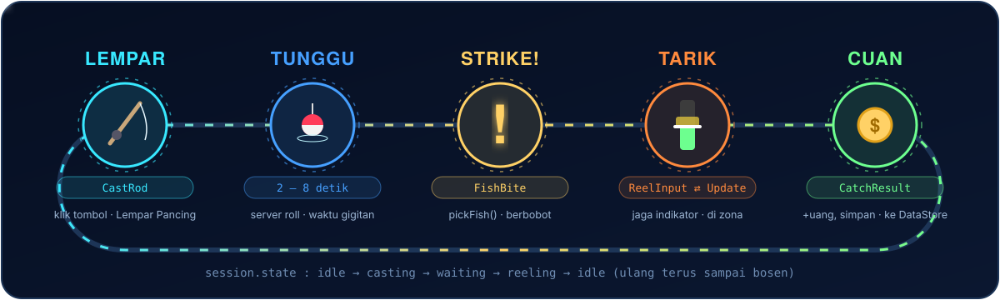

| Aksi | Kontrol | Yang terjadi |
|:--|:--:|:--|
| Lempar kail | klik tombol **`Lempar Pancing`** | Joran ter-equip otomatis, animasi ayunan diputar, server mengacak waktu gigitan 2–8 detik |
| Narik | tahan <kbd>🖱️ Klik kiri</kbd> atau <kbd>Space</kbd> | Indikator naik **+55/detik** |
| Ngulur | lepas tombol | Indikator turun **−40/detik** |
| Menang | progress sampai **100** | Popup tangkapan berwarna sesuai rarity, uang bertambah |
| Kalah | progress jatuh ke **0** atau lewat **20 detik** | *"Ikannya kabur..."* |

<details>
<summary><b>🔍 Lihat state machine sesi pemain (Mermaid, bisa di-zoom)</b></summary>
<br/>

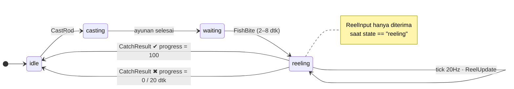

</details>


<!-- ═══════════════════════════════════════════════════════════════ 03 -->
<a id="reel"></a>


Animasi di bawah ini **bukan karangan**. Itu hasil port 1:1 dari `runReelMinigame()` ke Python, dijalankan dengan angka `Config.lua` yang asli melawan "pemain" bot yang sengaja dibuat agak ceroboh (telat bereaksi 300 ms dan kadang panik). Setiap frame di grafik adalah satu `ReelUpdate` yang dikirim server.


Tiap ikan punya angka `difficulty` (0–1) yang mengubah dua hal:

$$
\text{zoneSize} = 24 - (24 - 14)\cdot d \qquad\qquad \text{zoneSpeed} = 18\cdot(1 + d)
$$

Setiap tick ($\Delta t = 0.05$ dtk), progress bertambah atau berkurang tergantung posisi indikator:

$$
\text{progress}_{t+1} =
\begin{cases}
\text{progress}_t + 28\,\Delta t & \text{indikator di dalam zona}\\
\text{progress}_t - 18\,\Delta t & \text{di luar zona}
\end{cases}
$$

> [!TIP]
> Progress mulai dari **50**. Kalau indikator nempel di zona tanpa lepas, butuh minimal $50 / 28 \approx 1.79$ detik buat narik ikan apa pun. Sebaliknya, kalau meleset terus, ikan kabur setelah $50 / 18 \approx 2.78$ detik.

<details>
<summary><b>📜 Intip kode aslinya (FishingService.server.lua)</b></summary>
<br/>

```lua
-- Random-walk the zone center so it drifts unpredictably.
zoneVelocity += (math.random() * 2 - 1) * zoneSpeed * dt
zoneVelocity = clamp(zoneVelocity, -zoneSpeed, zoneSpeed)
zoneCenter = clamp(zoneCenter + zoneVelocity * dt, zoneSize / 2, Config.BarMax - zoneSize / 2)

if session.holding then
    indicator += Config.IndicatorRise * dt
else
    indicator -= Config.IndicatorFall * dt
end

local inside = indicator >= (zoneCenter - zoneSize / 2) and indicator <= (zoneCenter + zoneSize / 2)
progress += inside and Config.FillRate * dt or -Config.DrainRate * dt
```

</details>


<!-- ═══════════════════════════════════════════════════════════════ 04 -->
<a id="codex"></a>


<div align="center">

 
 
 
 
 

</div>

<details>
<summary><b>📊 Tabel mentah buat yang suka angka</b></summary>
<br/>

| # | Ikan | Rarity | Weight | Peluang | Rata-rata lemparan | Nilai | Difficulty | Zona | Kecepatan zona |
|--:|:--|:--|--:|--:|--:|--:|--:|--:|--:|
| 1 | Ikan Lele | ⚪ Common | 230 | 20.00% | 1 dari 5.0 | 5 | 0.10 | 23.0 | 19.8 |
| 2 | Ikan Mujair | ⚪ Common | 220 | 19.13% | 1 dari 5.2 | 8 | 0.12 | 22.8 | 20.2 |
| 3 | Ikan Nila | ⚪ Common | 210 | 18.26% | 1 dari 5.5 | 10 | 0.15 | 22.5 | 20.7 |
| 4 | Ikan Gurame | 🔵 Rare | 115 | 10.00% | 1 dari 10.0 | 28 | 0.30 | 21.0 | 23.4 |
| 5 | Ikan Kakap | 🔵 Rare | 105 | 9.13% | 1 dari 11.0 | 35 | 0.35 | 20.5 | 24.3 |
| 6 | Ikan Kerapu | 🔵 Rare | 150 | 13.04% | 1 dari 7.7 | 38 | 0.40 | 20.0 | 25.2 |
| 7 | Ikan Tuna | 🟣 Ultra Rare | 48 | 4.17% | 1 dari 24.0 | 75 | 0.50 | 19.0 | 27.0 |
| 8 | Ikan Hiu-Hiuan | 🟣 Ultra Rare | 42 | 3.65% | 1 dari 27.4 | 95 | 0.55 | 18.5 | 27.9 |
| 9 | Ikan Marlin | 🟠 Legendary | 25 | 2.17% | 1 dari 46.0 | 250 | 0.72 | 16.8 | 31.0 |
| 10 | Naga Laut | 🔴 Mythical | 5 | 0.43% | 1 dari 230.0 | 750 | 0.92 | 14.8 | 34.6 |

</details>


<!-- ═══════════════════════════════════════════════════════════════ 05 -->
<a id="drop"></a>


Begitu ikan menggigit, `pickFish()` melempar dadu berbobot. Setiap ikan punya `weight`, dan peluangnya adalah bobot itu dibagi total semua bobot:

$$
P(\text{ikan}_i) = \frac{w_i}{\sum_j w_j} = \frac{w_i}{1150}
\qquad\Rightarrow\qquad
\mathbb{E}[\text{uang per gigitan}] = \sum_i P_i \cdot v_i \approx 30.6
$$


<details>
<summary><b>🥧 Versi Mermaid (hover buat lihat angkanya)</b></summary>
<br/>

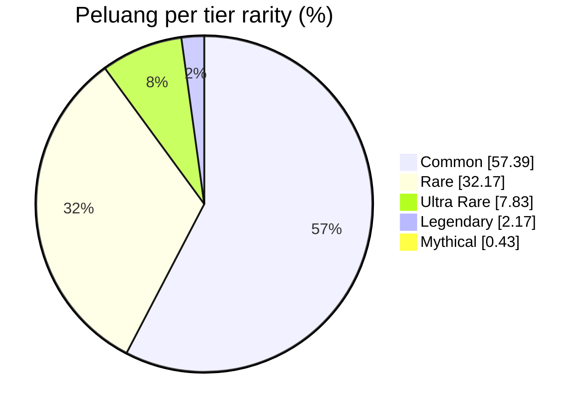

</details>

> [!NOTE]
> Komentar di `FishData.lua` menulis kisaran **~66% / 22% / 9% / 2.5% / 0.5%**, tapi kalau dihitung dari bobot yang sekarang, hasilnya **57.4% / 32.2% / 7.8% / 2.2% / 0.43%**. Penyebab utamanya Ikan Kerapu yang punya bobot 150, lebih besar dari dua ikan Rare lainnya. Angka di README ini memakai hasil hitungan asli.


<!-- ═══════════════════════════════════════════════════════════════ 06 -->
<a id="map"></a>



Kolam dibuat sekali jalan lewat `scripts/BuildPondTerrain.lua`: hapus `Baseplate`, isi tanah rumput 500×500, keruk cekungan, isi pasir dan air, lalu taruh `SpawnLocation` di daratan supaya pemain tidak muncul di tengah air. `PondAmbience` membaca angka yang sama (`SwimRadius = 36`, `MinY = -7`, `MaxY = -1.5`) supaya ikan hias tidak nembus pasir.

<details>
<summary><b>🧱 Cara menjalankan script terrain</b></summary>
<br/>

1. Buka Roblox Studio, masuk ke place kamu.
2. Buka **View → Command Bar**.
3. Copy seluruh isi [`scripts/BuildPondTerrain.lua`](scripts/BuildPondTerrain.lua), paste ke Command Bar, tekan <kbd>Enter</kbd>.
4. Output akan menampilkan `Kolam & terrain selesai dibuat!`

> [!WARNING]
> Script ini memanggil `Terrain:Clear()` dan menghapus `Baseplate`. Jangan dijalankan di place yang terrain-nya sudah kamu bentuk manual.

</details>


<!-- ═══════════════════════════════════════════════════════════════ 07 -->
<a id="arch"></a>


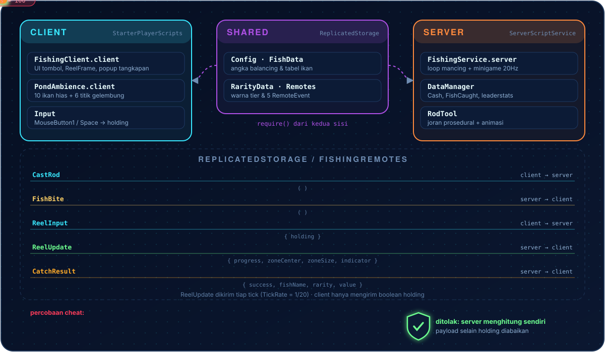

Prinsipnya sederhana: **client cuma pegang tombol, server pegang segalanya.** Satu-satunya data yang dikirim pemain selama minigame adalah `{ holding = true/false }`. Server sendiri yang menggeser zona, menggerakkan indikator, menghitung progress, memutuskan menang atau kalah, lalu membayar. Payload yang bukan tabel, atau dikirim saat state bukan `"reeling"`, langsung dibuang.

<details>
<summary><b>📡 Sequence diagram satu kali mancing</b></summary>
<br/>

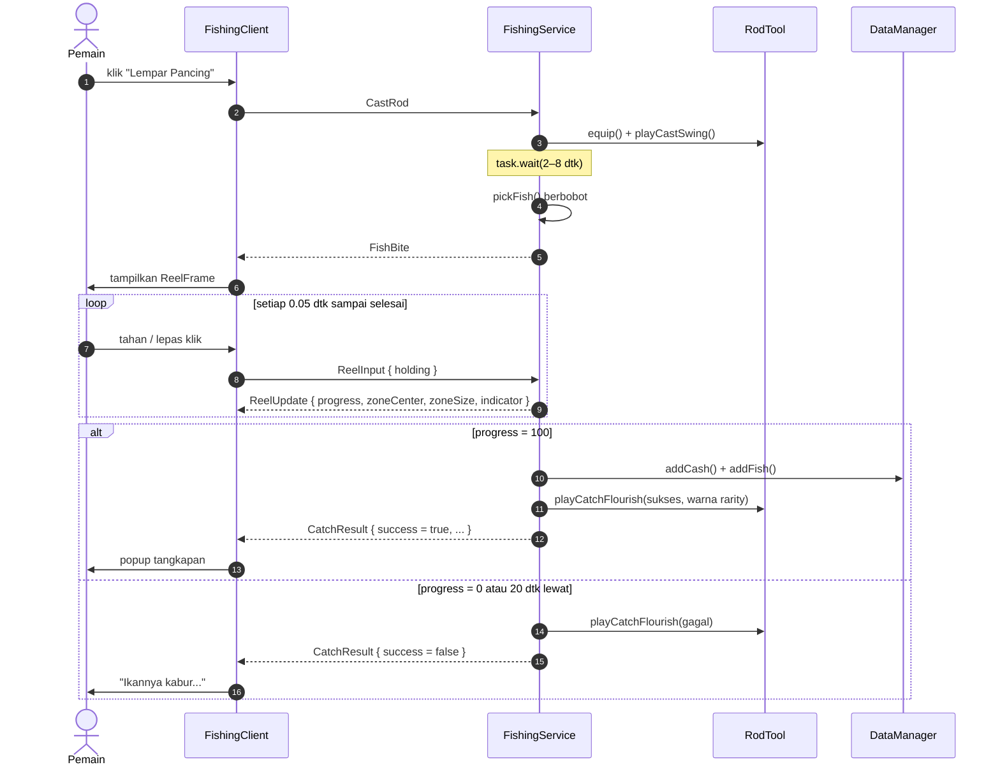

</details>


<!-- ═══════════════════════════════════════════════════════════════ 08 -->
<a id="tree"></a>


```text
CatchAndClash_Roblox_Project/
├── 📄 default.project.json            ← peta Rojo: folder → service Roblox
├── 📂 scripts/
│   └── 🧱 BuildPondTerrain.lua        ← jalankan sekali di Command Bar
└── 📂 src/
    ├── 📂 ReplicatedStorage/Fishing/      (dibaca client & server)
    │   ├── 🎛️ Config.lua              ← semua angka balancing minigame
    │   ├── 🐟 FishData.lua            ← 10 ikan: rarity, weight, value, difficulty
    │   ├── 🌈 RarityData.lua          ← urutan tier + warna
    │   └── 📡 Remotes.lua             ← bikin & ambil 5 RemoteEvent
    ├── 📂 ServerScriptService/Fishing/    (server saja)
    │   ├── 🧠 FishingService.server.lua   ← loop mancing + minigame otoritatif
    │   ├── 💾 DataManager.lua         ← DataStore + leaderstats
    │   └── 🎣 RodTool.lua             ← joran prosedural + animasi
    └── 📂 StarterPlayer/StarterPlayerScripts/Fishing/   (client saja)
        ├── 🖥️ FishingClient.client.lua    ← UI, input, popup tangkapan
        └── 🫧 PondAmbience.client.lua     ← ikan hias + gelembung
```

<details>
<summary><b>🔗 Bagaimana Rojo memetakan folder</b></summary>
<br/>

| Folder di repo | Muncul di Studio sebagai |
|:--|:--|
| `src/ReplicatedStorage/Fishing` | `ReplicatedStorage.Fishing` |
| `src/ServerScriptService/Fishing` | `ServerScriptService.Fishing` |
| `src/StarterPlayer/StarterPlayerScripts/Fishing` | `StarterPlayer.StarterPlayerScripts.Fishing` |

Akhiran `.server.lua` jadi `Script`, `.client.lua` jadi `LocalScript`, dan `.lua` biasa jadi `ModuleScript`.

</details>


<!-- ═══════════════════════════════════════════════════════════════ 09 -->
<a id="install"></a>


> [!IMPORTANT]
> Butuh **Roblox Studio** dan **[Rojo](https://rojo.space)** 7.x (CLI + plugin Studio).

**① Clone repo**

```bash
git clone https://github.com/<username>/CatchAndClash_Roblox_Project.git
cd CatchAndClash_Roblox_Project
```

**② Nyalakan Rojo**

```bash
rojo serve
```

**③ Sambungkan Studio.** Buka place baru (Baseplate), klik plugin **Rojo → Connect**. Folder `Fishing` akan muncul di tiga service.

**④ Bangun kolam.** Jalankan [`scripts/BuildPondTerrain.lua`](scripts/BuildPondTerrain.lua) di Command Bar (lihat [Peta Kolam](#map)).

**⑤ Tekan <kbd>F5</kbd> dan mulai mancing!** 🎣

<details>
<summary><b>📦 Mau file .rbxlx tanpa live sync?</b></summary>
<br/>

```bash
rojo build -o CatchAndClash.rbxlx
```

File hasil build sudah di-`.gitignore`, jadi aman.

</details>

> [!TIP]
> Supaya progres benar-benar tersimpan saat testing, publish place-nya lalu aktifkan **Game Settings → Security → Enable Studio Access to API Services**. Tanpa itu game tetap jalan normal, hanya saja `DataManager` akan memberi warning dan tidak menyimpan apa-apa.


<!-- ═══════════════════════════════════════════════════════════════ 10 -->
<a id="config"></a>


Semua angka balancing ada di [`src/ReplicatedStorage/Fishing/Config.lua`](src/ReplicatedStorage/Fishing/Config.lua).

| Kunci | Default | Efek kalau dinaikkan |
|:--|--:|:--|
| `MinBiteTime` / `MaxBiteTime` | `2` / `8` | Nunggu gigitan makin lama |
| `TickRate` | `1/20` | Simulasi makin jarang (lebih ringan, kurang halus) |
| `BarStart` | `50` | Mulai lebih dekat ke kemenangan |
| `FillRate` | `28` | Progress naik lebih cepat saat di zona |
| `DrainRate` | `18` | Hukuman meleset makin berat |
| `IndicatorRise` | `55` | Indikator makin "lompat" saat ditahan |
| `IndicatorFall` | `40` | Indikator jatuh makin cepat saat dilepas |
| `ZoneMinSize` / `ZoneMaxSize` | `14` / `24` | Zona lebih lebar (lebih gampang) |
| `ZoneSpeed` | `18` | Zona makin liar |
| `ReelTimeLimit` | `20` | Waktu narik lebih panjang |

<details>
<summary><b>➕ Cara menambah ikan baru</b></summary>
<br/>

Tambahkan satu baris di [`FishData.lua`](src/ReplicatedStorage/Fishing/FishData.lua). Tidak ada file lain yang perlu diubah: peluang, warna popup, dan tingkat kesulitan langsung ikut.

```lua
{ name = "Ikan Arwana", rarity = "Legendary", weight = 20, value = 300, difficulty = 0.75 },
```

Ingat, menambah `weight` akan mengecilkan peluang semua ikan lain karena total bobotnya ikut naik.

</details>

<details>
<summary><b>🎨 Cara mengganti warna tier</b></summary>
<br/>

Ubah `color` di [`RarityData.lua`](src/ReplicatedStorage/Fishing/RarityData.lua). Warna ini dipakai di label popup, garis tepi popup, dan efek ikan yang terangkat dari air.

| Tier | RGB | |
|:--|:--|:--:|
| Common | `190, 190, 190` |  |
| Rare | `70, 160, 255` |  |
| Ultra Rare | `175, 80, 230` |  |
| Legendary | `255, 170, 40` |  |
| Mythical | `255, 60, 90` |  |

</details>


<!-- ═══════════════════════════════════════════════════════════════ 11 -->
<a id="model"></a>


Joran di game dirakit dari kode, bukan mesh. Model di bawah ini dibangun ulang dari ukuran, kemiringan (3°, 5°, 6°, 7°), dan offset yang sama persis dengan `buildTemplate()` di `RodTool.lua`. **Bisa diputar, di-zoom, dan di-geser langsung di GitHub.** File aslinya ada di [`assets/readme/fishing-rod.stl`](assets/readme/fishing-rod.stl).

<details open>
<summary><b>🧊 Viewer 3D interaktif (drag untuk memutar)</b></summary>
<br/>

```stl
solid FishingRod
facet normal 0.0000 0.0000 -1.0000
outer loop
vertex -1.100 -5.000 -1.100
vertex 1.100 5.000 -1.100
vertex 1.100 -5.000 -1.100
endloop
endfacet
facet normal 0.0000 0.0000 -1.0000
outer loop
vertex -1.100 -5.000 -1.100
vertex -1.100 5.000 -1.100
vertex 1.100 5.000 -1.100
endloop
endfacet
facet normal 0.0000 0.0000 1.0000
outer loop
vertex -1.100 -5.000 1.100
vertex 1.100 -5.000 1.100
vertex 1.100 5.000 1.100
endloop
endfacet
facet normal 0.0000 0.0000 1.0000
outer loop
vertex -1.100 -5.000 1.100
vertex 1.100 5.000 1.100
vertex -1.100 5.000 1.100
endloop
endfacet
facet normal 0.0000 -1.0000 0.0000
outer loop
vertex -1.100 -5.000 -1.100
vertex 1.100 -5.000 -1.100
vertex 1.100 -5.000 1.100
endloop
endfacet
facet normal 0.0000 -1.0000 0.0000
outer loop
vertex -1.100 -5.000 -1.100
vertex 1.100 -5.000 1.100
vertex -1.100 -5.000 1.100
endloop
endfacet
facet normal 0.0000 1.0000 0.0000
outer loop
vertex 1.100 5.000 -1.100
vertex -1.100 5.000 -1.100
vertex -1.100 5.000 1.100
endloop
endfacet
facet normal 0.0000 1.0000 -0.0000
outer loop
vertex 1.100 5.000 -1.100
vertex -1.100 5.000 1.100
vertex 1.100 5.000 1.100
endloop
endfacet
facet normal 1.0000 0.0000 0.0000
outer loop
vertex 1.100 -5.000 -1.100
vertex 1.100 5.000 -1.100
vertex 1.100 5.000 1.100
endloop
endfacet
facet normal 1.0000 0.0000 0.0000
outer loop
vertex 1.100 -5.000 -1.100
vertex 1.100 5.000 1.100
vertex 1.100 -5.000 1.100
endloop
endfacet
facet normal -1.0000 0.0000 0.0000
outer loop
vertex -1.100 -5.000 -1.100
vertex -1.100 -5.000 1.100
vertex -1.100 5.000 1.100
endloop
endfacet
facet normal -1.0000 0.0000 0.0000
outer loop
vertex -1.100 -5.000 -1.100
vertex -1.100 5.000 1.100
vertex -1.100 5.000 -1.100
endloop
endfacet
facet normal 0.0000 -0.9808 -0.1951
outer loop
vertex -2.000 -0.500 2.800
vertex 2.000 -0.652 3.565
vertex -2.000 -0.652 3.565
endloop
endfacet
facet normal 0.0000 -0.9808 -0.1951
outer loop
vertex -2.000 -0.500 2.800
vertex 2.000 -0.500 2.800
vertex 2.000 -0.652 3.565
endloop
endfacet
facet normal -1.0000 0.0000 0.0000
outer loop
vertex -2.000 -2.500 2.800
vertex -2.000 -0.652 3.565
vertex -2.000 -0.500 2.800
endloop
endfacet
facet normal 1.0000 0.0000 0.0000
outer loop
vertex 2.000 -2.500 2.800
vertex 2.000 -0.500 2.800
vertex 2.000 -0.652 3.565
endloop
endfacet
facet normal 0.0000 -0.8315 -0.5556
outer loop
vertex -2.000 -0.652 3.565
vertex 2.000 -1.086 4.214
vertex -2.000 -1.086 4.214
endloop
endfacet
facet normal 0.0000 -0.8315 -0.5556
outer loop
vertex -2.000 -0.652 3.565
vertex 2.000 -0.652 3.565
vertex 2.000 -1.086 4.214
endloop
endfacet
facet normal -1.0000 0.0000 0.0000
outer loop
vertex -2.000 -2.500 2.800
vertex -2.000 -1.086 4.214
vertex -2.000 -0.652 3.565
endloop
endfacet
facet normal 1.0000 0.0000 0.0000
outer loop
vertex 2.000 -2.500 2.800
vertex 2.000 -0.652 3.565
vertex 2.000 -1.086 4.214
endloop
endfacet
facet normal 0.0000 -0.5556 -0.8315
outer loop
vertex -2.000 -1.086 4.214
vertex 2.000 -1.735 4.648
vertex -2.000 -1.735 4.648
endloop
endfacet
facet normal 0.0000 -0.5556 -0.8315
outer loop
vertex -2.000 -1.086 4.214
vertex 2.000 -1.086 4.214
vertex 2.000 -1.735 4.648
endloop
endfacet
facet normal -1.0000 0.0000 0.0000
outer loop
vertex -2.000 -2.500 2.800
vertex -2.000 -1.735 4.648
vertex -2.000 -1.086 4.214
endloop
endfacet
facet normal 1.0000 0.0000 0.0000
outer loop
vertex 2.000 -2.500 2.800
vertex 2.000 -1.086 4.214
vertex 2.000 -1.735 4.648
endloop
endfacet
facet normal 0.0000 -0.1951 -0.9808
outer loop
vertex -2.000 -1.735 4.648
vertex 2.000 -2.500 4.800
vertex -2.000 -2.500 4.800
endloop
endfacet
facet normal 0.0000 -0.1951 -0.9808
outer loop
vertex -2.000 -1.735 4.648
vertex 2.000 -1.735 4.648
vertex 2.000 -2.500 4.800
endloop
endfacet
facet normal -1.0000 0.0000 0.0000
outer loop
vertex -2.000 -2.500 2.800
vertex -2.000 -2.500 4.800
vertex -2.000 -1.735 4.648
endloop
endfacet
facet normal 1.0000 0.0000 0.0000
outer loop
vertex 2.000 -2.500 2.800
vertex 2.000 -1.735 4.648
vertex 2.000 -2.500 4.800
endloop
endfacet
facet normal 0.0000 0.1951 -0.9808
outer loop
vertex -2.000 -2.500 4.800
vertex 2.000 -3.265 4.648
vertex -2.000 -3.265 4.648
endloop
endfacet
facet normal 0.0000 0.1951 -0.9808
outer loop
vertex -2.000 -2.500 4.800
vertex 2.000 -2.500 4.800
vertex 2.000 -3.265 4.648
endloop
endfacet
facet normal -1.0000 0.0000 0.0000
outer loop
vertex -2.000 -2.500 2.800
vertex -2.000 -3.265 4.648
vertex -2.000 -2.500 4.800
endloop
endfacet
facet normal 1.0000 0.0000 -0.0000
outer loop
vertex 2.000 -2.500 2.800
vertex 2.000 -2.500 4.800
vertex 2.000 -3.265 4.648
endloop
endfacet
facet normal 0.0000 0.5556 -0.8315
outer loop
vertex -2.000 -3.265 4.648
vertex 2.000 -3.914 4.214
vertex -2.000 -3.914 4.214
endloop
endfacet
facet normal 0.0000 0.5556 -0.8315
outer loop
vertex -2.000 -3.265 4.648
vertex 2.000 -3.265 4.648
vertex 2.000 -3.914 4.214
endloop
endfacet
facet normal -1.0000 0.0000 0.0000
outer loop
vertex -2.000 -2.500 2.800
vertex -2.000 -3.914 4.214
vertex -2.000 -3.265 4.648
endloop
endfacet
facet normal 1.0000 0.0000 0.0000
outer loop
vertex 2.000 -2.500 2.800
vertex 2.000 -3.265 4.648
vertex 2.000 -3.914 4.214
endloop
endfacet
facet normal 0.0000 0.8315 -0.5556
outer loop
vertex -2.000 -3.914 4.214
vertex 2.000 -4.348 3.565
vertex -2.000 -4.348 3.565
endloop
endfacet
facet normal 0.0000 0.8315 -0.5556
outer loop
vertex -2.000 -3.914 4.214
vertex 2.000 -3.914 4.214
vertex 2.000 -4.348 3.565
endloop
endfacet
facet normal -1.0000 0.0000 0.0000
outer loop
vertex -2.000 -2.500 2.800
vertex -2.000 -4.348 3.565
vertex -2.000 -3.914 4.214
endloop
endfacet
facet normal 1.0000 0.0000 0.0000
outer loop
vertex 2.000 -2.500 2.800
vertex 2.000 -3.914 4.214
vertex 2.000 -4.348 3.565
endloop
endfacet
facet normal 0.0000 0.9808 -0.1951
outer loop
vertex -2.000 -4.348 3.565
vertex 2.000 -4.500 2.800
vertex -2.000 -4.500 2.800
endloop
endfacet
facet normal 0.0000 0.9808 -0.1951
outer loop
vertex -2.000 -4.348 3.565
vertex 2.000 -4.348 3.565
vertex 2.000 -4.500 2.800
endloop
endfacet
facet normal -1.0000 0.0000 0.0000
outer loop
vertex -2.000 -2.500 2.800
vertex -2.000 -4.500 2.800
vertex -2.000 -4.348 3.565
endloop
endfacet
facet normal 1.0000 0.0000 0.0000
outer loop
vertex 2.000 -2.500 2.800
vertex 2.000 -4.348 3.565
vertex 2.000 -4.500 2.800
endloop
endfacet
facet normal 0.0000 0.9808 0.1951
outer loop
vertex -2.000 -4.500 2.800
vertex 2.000 -4.348 2.035
vertex -2.000 -4.348 2.035
endloop
endfacet
facet normal -0.0000 0.9808 0.1951
outer loop
vertex -2.000 -4.500 2.800
vertex 2.000 -4.500 2.800
vertex 2.000 -4.348 2.035
endloop
endfacet
facet normal -1.0000 -0.0000 0.0000
outer loop
vertex -2.000 -2.500 2.800
vertex -2.000 -4.348 2.035
vertex -2.000 -4.500 2.800
endloop
endfacet
facet normal 1.0000 0.0000 0.0000
outer loop
vertex 2.000 -2.500 2.800
vertex 2.000 -4.500 2.800
vertex 2.000 -4.348 2.035
endloop
endfacet
facet normal 0.0000 0.8315 0.5556
outer loop
vertex -2.000 -4.348 2.035
vertex 2.000 -3.914 1.386
vertex -2.000 -3.914 1.386
endloop
endfacet
facet normal -0.0000 0.8315 0.5556
outer loop
vertex -2.000 -4.348 2.035
vertex 2.000 -4.348 2.035
vertex 2.000 -3.914 1.386
endloop
endfacet
facet normal -1.0000 0.0000 0.0000
outer loop
vertex -2.000 -2.500 2.800
vertex -2.000 -3.914 1.386
vertex -2.000 -4.348 2.035
endloop
endfacet
facet normal 1.0000 0.0000 0.0000
outer loop
vertex 2.000 -2.500 2.800
vertex 2.000 -4.348 2.035
vertex 2.000 -3.914 1.386
endloop
endfacet
facet normal 0.0000 0.5556 0.8315
outer loop
vertex -2.000 -3.914 1.386
vertex 2.000 -3.265 0.952
vertex -2.000 -3.265 0.952
endloop
endfacet
facet normal -0.0000 0.5556 0.8315
outer loop
vertex -2.000 -3.914 1.386
vertex 2.000 -3.914 1.386
vertex 2.000 -3.265 0.952
endloop
endfacet
facet normal -1.0000 0.0000 0.0000
outer loop
vertex -2.000 -2.500 2.800
vertex -2.000 -3.265 0.952
vertex -2.000 -3.914 1.386
endloop
endfacet
facet normal 1.0000 0.0000 0.0000
outer loop
vertex 2.000 -2.500 2.800
vertex 2.000 -3.914 1.386
vertex 2.000 -3.265 0.952
endloop
endfacet
facet normal 0.0000 0.1951 0.9808
outer loop
vertex -2.000 -3.265 0.952
vertex 2.000 -2.500 0.800
vertex -2.000 -2.500 0.800
endloop
endfacet
facet normal -0.0000 0.1951 0.9808
outer loop
vertex -2.000 -3.265 0.952
vertex 2.000 -3.265 0.952
vertex 2.000 -2.500 0.800
endloop
endfacet
facet normal -1.0000 0.0000 0.0000
outer loop
vertex -2.000 -2.500 2.800
vertex -2.000 -2.500 0.800
vertex -2.000 -3.265 0.952
endloop
endfacet
facet normal 1.0000 0.0000 0.0000
outer loop
vertex 2.000 -2.500 2.800
vertex 2.000 -3.265 0.952
vertex 2.000 -2.500 0.800
endloop
endfacet
facet normal 0.0000 -0.1951 0.9808
outer loop
vertex -2.000 -2.500 0.800
vertex 2.000 -1.735 0.952
vertex -2.000 -1.735 0.952
endloop
endfacet
facet normal 0.0000 -0.1951 0.9808
outer loop
vertex -2.000 -2.500 0.800
vertex 2.000 -2.500 0.800
vertex 2.000 -1.735 0.952
endloop
endfacet
facet normal -1.0000 0.0000 -0.0000
outer loop
vertex -2.000 -2.500 2.800
vertex -2.000 -1.735 0.952
vertex -2.000 -2.500 0.800
endloop
endfacet
facet normal 1.0000 0.0000 0.0000
outer loop
vertex 2.000 -2.500 2.800
vertex 2.000 -2.500 0.800
vertex 2.000 -1.735 0.952
endloop
endfacet
facet normal 0.0000 -0.5556 0.8315
outer loop
vertex -2.000 -1.735 0.952
vertex 2.000 -1.086 1.386
vertex -2.000 -1.086 1.386
endloop
endfacet
facet normal 0.0000 -0.5556 0.8315
outer loop
vertex -2.000 -1.735 0.952
vertex 2.000 -1.735 0.952
vertex 2.000 -1.086 1.386
endloop
endfacet
facet normal -1.0000 0.0000 0.0000
outer loop
vertex -2.000 -2.500 2.800
vertex -2.000 -1.086 1.386
vertex -2.000 -1.735 0.952
endloop
endfacet
facet normal 1.0000 0.0000 0.0000
outer loop
vertex 2.000 -2.500 2.800
vertex 2.000 -1.735 0.952
vertex 2.000 -1.086 1.386
endloop
endfacet
facet normal 0.0000 -0.8315 0.5556
outer loop
vertex -2.000 -1.086 1.386
vertex 2.000 -0.652 2.035
vertex -2.000 -0.652 2.035
endloop
endfacet
facet normal 0.0000 -0.8315 0.5556
outer loop
vertex -2.000 -1.086 1.386
vertex 2.000 -1.086 1.386
vertex 2.000 -0.652 2.035
endloop
endfacet
facet normal -1.0000 0.0000 0.0000
outer loop
vertex -2.000 -2.500 2.800
vertex -2.000 -0.652 2.035
vertex -2.000 -1.086 1.386
endloop
endfacet
facet normal 1.0000 0.0000 0.0000
outer loop
vertex 2.000 -2.500 2.800
vertex 2.000 -1.086 1.386
vertex 2.000 -0.652 2.035
endloop
endfacet
facet normal 0.0000 -0.9808 0.1951
outer loop
vertex -2.000 -0.652 2.035
vertex 2.000 -0.500 2.800
vertex -2.000 -0.500 2.800
endloop
endfacet
facet normal 0.0000 -0.9808 0.1951
outer loop
vertex -2.000 -0.652 2.035
vertex 2.000 -0.652 2.035
vertex 2.000 -0.500 2.800
endloop
endfacet
facet normal -1.0000 0.0000 0.0000
outer loop
vertex -2.000 -2.500 2.800
vertex -2.000 -0.500 2.800
vertex -2.000 -0.652 2.035
endloop
endfacet
facet normal 1.0000 0.0000 0.0000
outer loop
vertex 2.000 -2.500 2.800
vertex 2.000 -0.652 2.035
vertex 2.000 -0.500 2.800
endloop
endfacet
facet normal 0.0000 0.0000 -1.0000
outer loop
vertex 2.200 -4.000 2.550
vertex 2.600 -1.000 2.550
vertex 2.600 -4.000 2.550
endloop
endfacet
facet normal 0.0000 0.0000 -1.0000
outer loop
vertex 2.200 -4.000 2.550
vertex 2.200 -1.000 2.550
vertex 2.600 -1.000 2.550
endloop
endfacet
facet normal 0.0000 0.0000 1.0000
outer loop
vertex 2.200 -4.000 3.050
vertex 2.600 -4.000 3.050
vertex 2.600 -1.000 3.050
endloop
endfacet
facet normal 0.0000 0.0000 1.0000
outer loop
vertex 2.200 -4.000 3.050
vertex 2.600 -1.000 3.050
vertex 2.200 -1.000 3.050
endloop
endfacet
facet normal 0.0000 -1.0000 0.0000
outer loop
vertex 2.200 -4.000 2.550
vertex 2.600 -4.000 2.550
vertex 2.600 -4.000 3.050
endloop
endfacet
facet normal 0.0000 -1.0000 0.0000
outer loop
vertex 2.200 -4.000 2.550
vertex 2.600 -4.000 3.050
vertex 2.200 -4.000 3.050
endloop
endfacet
facet normal 0.0000 1.0000 0.0000
outer loop
vertex 2.600 -1.000 2.550
vertex 2.200 -1.000 2.550
vertex 2.200 -1.000 3.050
endloop
endfacet
facet normal 0.0000 1.0000 -0.0000
outer loop
vertex 2.600 -1.000 2.550
vertex 2.200 -1.000 3.050
vertex 2.600 -1.000 3.050
endloop
endfacet
facet normal 1.0000 0.0000 0.0000
outer loop
vertex 2.600 -4.000 2.550
vertex 2.600 -1.000 2.550
vertex 2.600 -1.000 3.050
endloop
endfacet
facet normal 1.0000 0.0000 0.0000
outer loop
vertex 2.600 -4.000 2.550
vertex 2.600 -1.000 3.050
vertex 2.600 -4.000 3.050
endloop
endfacet
facet normal -1.0000 0.0000 0.0000
outer loop
vertex 2.200 -4.000 2.550
vertex 2.200 -4.000 3.050
vertex 2.200 -1.000 3.050
endloop
endfacet
facet normal -1.0000 0.0000 0.0000
outer loop
vertex 2.200 -4.000 2.550
vertex 2.200 -1.000 3.050
vertex 2.200 -1.000 2.550
endloop
endfacet
facet normal 0.0000 0.0523 -0.9986
outer loop
vertex -0.850 5.044 -0.849
vertex 0.850 18.027 -0.168
vertex 0.850 5.044 -0.849
endloop
endfacet
facet normal 0.0000 0.0523 -0.9986
outer loop
vertex -0.850 5.044 -0.849
vertex -0.850 18.027 -0.168
vertex 0.850 18.027 -0.168
endloop
endfacet
facet normal 0.0000 -0.0523 0.9986
outer loop
vertex -0.850 4.956 0.849
vertex 0.850 4.956 0.849
vertex 0.850 17.938 1.529
endloop
endfacet
facet normal 0.0000 -0.0523 0.9986
outer loop
vertex -0.850 4.956 0.849
vertex 0.850 17.938 1.529
vertex -0.850 17.938 1.529
endloop
endfacet
facet normal 0.0000 -0.9986 -0.0523
outer loop
vertex -0.850 5.044 -0.849
vertex 0.850 5.044 -0.849
vertex 0.850 4.956 0.849
endloop
endfacet
facet normal 0.0000 -0.9986 -0.0523
outer loop
vertex -0.850 5.044 -0.849
vertex 0.850 4.956 0.849
vertex -0.850 4.956 0.849
endloop
endfacet
facet normal 0.0000 0.9986 0.0523
outer loop
vertex 0.850 18.027 -0.168
vertex -0.850 18.027 -0.168
vertex -0.850 17.938 1.529
endloop
endfacet
facet normal 0.0000 0.9986 0.0523
outer loop
vertex 0.850 18.027 -0.168
vertex -0.850 17.938 1.529
vertex 0.850 17.938 1.529
endloop
endfacet
facet normal 1.0000 0.0000 0.0000
outer loop
vertex 0.850 5.044 -0.849
vertex 0.850 18.027 -0.168
vertex 0.850 17.938 1.529
endloop
endfacet
facet normal 1.0000 0.0000 -0.0000
outer loop
vertex 0.850 5.044 -0.849
vertex 0.850 17.938 1.529
vertex 0.850 4.956 0.849
endloop
endfacet
facet normal -1.0000 0.0000 0.0000
outer loop
vertex -0.850 5.044 -0.849
vertex -0.850 4.956 0.849
vertex -0.850 17.938 1.529
endloop
endfacet
facet normal -1.0000 0.0000 0.0000
outer loop
vertex -0.850 5.044 -0.849
vertex -0.850 17.938 1.529
vertex -0.850 18.027 -0.168
endloop
endfacet
facet normal 0.9239 0.0200 -0.3822
outer loop
vertex -0.500 17.882 0.675
vertex -0.354 18.064 1.039
vertex -0.354 17.864 1.028
endloop
endfacet
facet normal 0.9239 0.0200 -0.3822
outer loop
vertex -0.500 17.882 0.675
vertex -0.500 18.082 0.686
vertex -0.354 18.064 1.039
endloop
endfacet
facet normal -0.0000 -0.9986 -0.0523
outer loop
vertex -0.000 17.882 0.675
vertex -0.354 17.864 1.028
vertex -0.500 17.882 0.675
endloop
endfacet
facet normal 0.0000 0.9986 0.0523
outer loop
vertex 0.000 18.082 0.686
vertex -0.500 18.082 0.686
vertex -0.354 18.064 1.039
endloop
endfacet
facet normal 0.3827 0.0484 -0.9226
outer loop
vertex -0.354 17.864 1.028
vertex -0.000 18.056 1.185
vertex -0.000 17.856 1.174
endloop
endfacet
facet normal 0.3827 0.0484 -0.9226
outer loop
vertex -0.354 17.864 1.028
vertex -0.354 18.064 1.039
vertex -0.000 18.056 1.185
endloop
endfacet
facet normal 0.0000 -0.9986 -0.0523
outer loop
vertex -0.000 17.882 0.675
vertex -0.000 17.856 1.174
vertex -0.354 17.864 1.028
endloop
endfacet
facet normal 0.0000 0.9986 0.0523
outer loop
vertex 0.000 18.082 0.686
vertex -0.354 18.064 1.039
vertex -0.000 18.056 1.185
endloop
endfacet
facet normal -0.3827 0.0484 -0.9226
outer loop
vertex -0.000 17.856 1.174
vertex 0.354 18.064 1.039
vertex 0.354 17.864 1.028
endloop
endfacet
facet normal -0.3827 0.0484 -0.9226
outer loop
vertex -0.000 17.856 1.174
vertex -0.000 18.056 1.185
vertex 0.354 18.064 1.039
endloop
endfacet
facet normal -0.0000 -0.9986 -0.0523
outer loop
vertex -0.000 17.882 0.675
vertex 0.354 17.864 1.028
vertex -0.000 17.856 1.174
endloop
endfacet
facet normal -0.0000 0.9986 0.0523
outer loop
vertex 0.000 18.082 0.686
vertex -0.000 18.056 1.185
vertex 0.354 18.064 1.039
endloop
endfacet
facet normal -0.9239 0.0200 -0.3822
outer loop
vertex 0.354 17.864 1.028
vertex 0.500 18.082 0.686
vertex 0.500 17.882 0.675
endloop
endfacet
facet normal -0.9239 0.0200 -0.3822
outer loop
vertex 0.354 17.864 1.028
vertex 0.354 18.064 1.039
vertex 0.500 18.082 0.686
endloop
endfacet
facet normal 0.0000 -0.9986 -0.0523
outer loop
vertex -0.000 17.882 0.675
vertex 0.500 17.882 0.675
vertex 0.354 17.864 1.028
endloop
endfacet
facet normal -0.0000 0.9986 0.0523
outer loop
vertex 0.000 18.082 0.686
vertex 0.354 18.064 1.039
vertex 0.500 18.082 0.686
endloop
endfacet
facet normal -0.9239 -0.0200 0.3822
outer loop
vertex 0.500 17.882 0.675
vertex 0.354 18.101 0.333
vertex 0.354 17.901 0.322
endloop
endfacet
facet normal -0.9239 -0.0200 0.3822
outer loop
vertex 0.500 17.882 0.675
vertex 0.500 18.082 0.686
vertex 0.354 18.101 0.333
endloop
endfacet
facet normal 0.0000 -0.9986 -0.0523
outer loop
vertex -0.000 17.882 0.675
vertex 0.354 17.901 0.322
vertex 0.500 17.882 0.675
endloop
endfacet
facet normal -0.0000 0.9986 0.0523
outer loop
vertex 0.000 18.082 0.686
vertex 0.500 18.082 0.686
vertex 0.354 18.101 0.333
endloop
endfacet
facet normal -0.3827 -0.0484 0.9226
outer loop
vertex 0.354 17.901 0.322
vertex 0.000 18.108 0.186
vertex 0.000 17.908 0.176
endloop
endfacet
facet normal -0.3827 -0.0484 0.9226
outer loop
vertex 0.354 17.901 0.322
vertex 0.354 18.101 0.333
vertex 0.000 18.108 0.186
endloop
endfacet
facet normal -0.0000 -0.9986 -0.0523
outer loop
vertex -0.000 17.882 0.675
vertex 0.000 17.908 0.176
vertex 0.354 17.901 0.322
endloop
endfacet
facet normal -0.0000 0.9986 0.0523
outer loop
vertex 0.000 18.082 0.686
vertex 0.354 18.101 0.333
vertex 0.000 18.108 0.186
endloop
endfacet
facet normal 0.3827 -0.0484 0.9226
outer loop
vertex 0.000 17.908 0.176
vertex -0.354 18.101 0.333
vertex -0.354 17.901 0.322
endloop
endfacet
facet normal 0.3827 -0.0484 0.9226
outer loop
vertex 0.000 17.908 0.176
vertex 0.000 18.108 0.186
vertex -0.354 18.101 0.333
endloop
endfacet
facet normal 0.0000 -0.9986 -0.0523
outer loop
vertex -0.000 17.882 0.675
vertex -0.354 17.901 0.322
vertex 0.000 17.908 0.176
endloop
endfacet
facet normal 0.0000 0.9986 0.0523
outer loop
vertex 0.000 18.082 0.686
vertex 0.000 18.108 0.186
vertex -0.354 18.101 0.333
endloop
endfacet
facet normal 0.9239 -0.0200 0.3822
outer loop
vertex -0.354 17.901 0.322
vertex -0.500 18.082 0.686
vertex -0.500 17.882 0.675
endloop
endfacet
facet normal 0.9239 -0.0200 0.3822
outer loop
vertex -0.354 17.901 0.322
vertex -0.354 18.101 0.333
vertex -0.500 18.082 0.686
endloop
endfacet
facet normal 0.0000 -0.9986 -0.0523
outer loop
vertex -0.000 17.882 0.675
vertex -0.500 17.882 0.675
vertex -0.354 17.901 0.322
endloop
endfacet
facet normal -0.0000 0.9986 0.0523
outer loop
vertex 0.000 18.082 0.686
vertex -0.354 18.101 0.333
vertex -0.500 18.082 0.686
endloop
endfacet
facet normal 0.0000 0.1392 -0.9903
outer loop
vertex -0.650 18.073 0.037
vertex 0.650 30.946 1.846
vertex 0.650 18.073 0.037
endloop
endfacet
facet normal 0.0000 0.1392 -0.9903
outer loop
vertex -0.650 18.073 0.037
vertex -0.650 30.946 1.846
vertex 0.650 30.946 1.846
endloop
endfacet
facet normal 0.0000 -0.1392 0.9903
outer loop
vertex -0.650 17.892 1.324
vertex 0.650 17.892 1.324
vertex 0.650 30.765 3.133
endloop
endfacet
facet normal 0.0000 -0.1392 0.9903
outer loop
vertex -0.650 17.892 1.324
vertex 0.650 30.765 3.133
vertex -0.650 30.765 3.133
endloop
endfacet
facet normal 0.0000 -0.9903 -0.1392
outer loop
vertex -0.650 18.073 0.037
vertex 0.650 18.073 0.037
vertex 0.650 17.892 1.324
endloop
endfacet
facet normal 0.0000 -0.9903 -0.1392
outer loop
vertex -0.650 18.073 0.037
vertex 0.650 17.892 1.324
vertex -0.650 17.892 1.324
endloop
endfacet
facet normal 0.0000 0.9903 0.1392
outer loop
vertex 0.650 30.946 1.846
vertex -0.650 30.946 1.846
vertex -0.650 30.765 3.133
endloop
endfacet
facet normal 0.0000 0.9903 0.1392
outer loop
vertex 0.650 30.946 1.846
vertex -0.650 30.765 3.133
vertex 0.650 30.765 3.133
endloop
endfacet
facet normal 1.0000 0.0000 0.0000
outer loop
vertex 0.650 18.073 0.037
vertex 0.650 30.946 1.846
vertex 0.650 30.765 3.133
endloop
endfacet
facet normal 1.0000 0.0000 -0.0000
outer loop
vertex 0.650 18.073 0.037
vertex 0.650 30.765 3.133
vertex 0.650 17.892 1.324
endloop
endfacet
facet normal -1.0000 0.0000 0.0000
outer loop
vertex -0.650 18.073 0.037
vertex -0.650 17.892 1.324
vertex -0.650 30.765 3.133
endloop
endfacet
facet normal -1.0000 0.0000 0.0000
outer loop
vertex -0.650 18.073 0.037
vertex -0.650 30.765 3.133
vertex -0.650 30.946 1.846
endloop
endfacet
facet normal 0.9239 0.0533 -0.3790
outer loop
vertex -0.500 30.757 2.476
vertex -0.354 30.905 2.854
vertex -0.354 30.707 2.826
endloop
endfacet
facet normal 0.9239 0.0533 -0.3790
outer loop
vertex -0.500 30.757 2.476
vertex -0.500 30.955 2.504
vertex -0.354 30.905 2.854
endloop
endfacet
facet normal -0.0000 -0.9903 -0.1392
outer loop
vertex -0.000 30.757 2.476
vertex -0.354 30.707 2.826
vertex -0.500 30.757 2.476
endloop
endfacet
facet normal 0.0000 0.9903 0.1392
outer loop
vertex 0.000 30.955 2.504
vertex -0.500 30.955 2.504
vertex -0.354 30.905 2.854
endloop
endfacet
facet normal 0.3827 0.1286 -0.9149
outer loop
vertex -0.354 30.707 2.826
vertex -0.000 30.885 2.999
vertex -0.000 30.687 2.971
endloop
endfacet
facet normal 0.3827 0.1286 -0.9149
outer loop
vertex -0.354 30.707 2.826
vertex -0.354 30.905 2.854
vertex -0.000 30.885 2.999
endloop
endfacet
facet normal 0.0000 -0.9903 -0.1392
outer loop
vertex -0.000 30.757 2.476
vertex -0.000 30.687 2.971
vertex -0.354 30.707 2.826
endloop
endfacet
facet normal -0.0000 0.9903 0.1392
outer loop
vertex 0.000 30.955 2.504
vertex -0.354 30.905 2.854
vertex -0.000 30.885 2.999
endloop
endfacet
facet normal -0.3827 0.1286 -0.9149
outer loop
vertex -0.000 30.687 2.971
vertex 0.354 30.905 2.854
vertex 0.354 30.707 2.826
endloop
endfacet
facet normal -0.3827 0.1286 -0.9149
outer loop
vertex -0.000 30.687 2.971
vertex -0.000 30.885 2.999
vertex 0.354 30.905 2.854
endloop
endfacet
facet normal -0.0000 -0.9903 -0.1392
outer loop
vertex -0.000 30.757 2.476
vertex 0.354 30.707 2.826
vertex -0.000 30.687 2.971
endloop
endfacet
facet normal 0.0000 0.9903 0.1392
outer loop
vertex 0.000 30.955 2.504
vertex -0.000 30.885 2.999
vertex 0.354 30.905 2.854
endloop
endfacet
facet normal -0.9239 0.0533 -0.3790
outer loop
vertex 0.354 30.707 2.826
vertex 0.500 30.955 2.504
vertex 0.500 30.757 2.476
endloop
endfacet
facet normal -0.9239 0.0533 -0.3790
outer loop
vertex 0.354 30.707 2.826
vertex 0.354 30.905 2.854
vertex 0.500 30.955 2.504
endloop
endfacet
facet normal 0.0000 -0.9903 -0.1392
outer loop
vertex -0.000 30.757 2.476
vertex 0.500 30.757 2.476
vertex 0.354 30.707 2.826
endloop
endfacet
facet normal -0.0000 0.9903 0.1392
outer loop
vertex 0.000 30.955 2.504
vertex 0.354 30.905 2.854
vertex 0.500 30.955 2.504
endloop
endfacet
facet normal -0.9239 -0.0533 0.3790
outer loop
vertex 0.500 30.757 2.476
vertex 0.354 31.004 2.153
vertex 0.354 30.806 2.126
endloop
endfacet
facet normal -0.9239 -0.0533 0.3790
outer loop
vertex 0.500 30.757 2.476
vertex 0.500 30.955 2.504
vertex 0.354 31.004 2.153
endloop
endfacet
facet normal 0.0000 -0.9903 -0.1392
outer loop
vertex -0.000 30.757 2.476
vertex 0.354 30.806 2.126
vertex 0.500 30.757 2.476
endloop
endfacet
facet normal -0.0000 0.9903 0.1392
outer loop
vertex 0.000 30.955 2.504
vertex 0.500 30.955 2.504
vertex 0.354 31.004 2.153
endloop
endfacet
facet normal -0.3827 -0.1286 0.9149
outer loop
vertex 0.354 30.806 2.126
vertex 0.000 31.024 2.008
vertex 0.000 30.826 1.981
endloop
endfacet
facet normal -0.3827 -0.1286 0.9149
outer loop
vertex 0.354 30.806 2.126
vertex 0.354 31.004 2.153
vertex 0.000 31.024 2.008
endloop
endfacet
facet normal 0.0000 -0.9903 -0.1392
outer loop
vertex -0.000 30.757 2.476
vertex 0.000 30.826 1.981
vertex 0.354 30.806 2.126
endloop
endfacet
facet normal -0.0000 0.9903 0.1392
outer loop
vertex 0.000 30.955 2.504
vertex 0.354 31.004 2.153
vertex 0.000 31.024 2.008
endloop
endfacet
facet normal 0.3827 -0.1286 0.9149
outer loop
vertex 0.000 30.826 1.981
vertex -0.354 31.004 2.153
vertex -0.354 30.806 2.126
endloop
endfacet
facet normal 0.3827 -0.1286 0.9149
outer loop
vertex 0.000 30.826 1.981
vertex 0.000 31.024 2.008
vertex -0.354 31.004 2.153
endloop
endfacet
facet normal -0.0000 -0.9903 -0.1392
outer loop
vertex -0.000 30.757 2.476
vertex -0.354 30.806 2.126
vertex 0.000 30.826 1.981
endloop
endfacet
facet normal 0.0000 0.9903 0.1392
outer loop
vertex 0.000 30.955 2.504
vertex 0.000 31.024 2.008
vertex -0.354 31.004 2.153
endloop
endfacet
facet normal 0.9239 -0.0533 0.3790
outer loop
vertex -0.354 30.806 2.126
vertex -0.500 30.955 2.504
vertex -0.500 30.757 2.476
endloop
endfacet
facet normal 0.9239 -0.0533 0.3790
outer loop
vertex -0.354 30.806 2.126
vertex -0.354 31.004 2.153
vertex -0.500 30.955 2.504
endloop
endfacet
facet normal 0.0000 -0.9903 -0.1392
outer loop
vertex -0.000 30.757 2.476
vertex -0.500 30.757 2.476
vertex -0.354 30.806 2.126
endloop
endfacet
facet normal 0.0000 0.9903 0.1392
outer loop
vertex 0.000 30.955 2.504
vertex -0.354 31.004 2.153
vertex -0.500 30.955 2.504
endloop
endfacet
facet normal 0.0000 0.2419 -0.9703
outer loop
vertex -0.450 30.965 2.053
vertex 0.450 42.608 4.956
vertex 0.450 30.965 2.053
endloop
endfacet
facet normal 0.0000 0.2419 -0.9703
outer loop
vertex -0.450 30.965 2.053
vertex -0.450 42.608 4.956
vertex 0.450 42.608 4.956
endloop
endfacet
facet normal 0.0000 -0.2419 0.9703
outer loop
vertex -0.450 30.747 2.926
vertex 0.450 30.747 2.926
vertex 0.450 42.390 5.829
endloop
endfacet
facet normal 0.0000 -0.2419 0.9703
outer loop
vertex -0.450 30.747 2.926
vertex 0.450 42.390 5.829
vertex -0.450 42.390 5.829
endloop
endfacet
facet normal 0.0000 -0.9703 -0.2419
outer loop
vertex -0.450 30.965 2.053
vertex 0.450 30.965 2.053
vertex 0.450 30.747 2.926
endloop
endfacet
facet normal 0.0000 -0.9703 -0.2419
outer loop
vertex -0.450 30.965 2.053
vertex 0.450 30.747 2.926
vertex -0.450 30.747 2.926
endloop
endfacet
facet normal 0.0000 0.9703 0.2419
outer loop
vertex 0.450 42.608 4.956
vertex -0.450 42.608 4.956
vertex -0.450 42.390 5.829
endloop
endfacet
facet normal 0.0000 0.9703 0.2419
outer loop
vertex 0.450 42.608 4.956
vertex -0.450 42.390 5.829
vertex 0.450 42.390 5.829
endloop
endfacet
facet normal 1.0000 0.0000 0.0000
outer loop
vertex 0.450 30.965 2.053
vertex 0.450 42.608 4.956
vertex 0.450 42.390 5.829
endloop
endfacet
facet normal 1.0000 0.0000 -0.0000
outer loop
vertex 0.450 30.965 2.053
vertex 0.450 42.390 5.829
vertex 0.450 30.747 2.926
endloop
endfacet
facet normal -1.0000 0.0000 0.0000
outer loop
vertex -0.450 30.965 2.053
vertex -0.450 30.747 2.926
vertex -0.450 42.390 5.829
endloop
endfacet
facet normal -1.0000 0.0000 0.0000
outer loop
vertex -0.450 30.965 2.053
vertex -0.450 42.390 5.829
vertex -0.450 42.608 4.956
endloop
endfacet
facet normal 0.9239 0.0926 -0.3713
outer loop
vertex -0.500 42.402 5.368
vertex -0.354 42.511 5.760
vertex -0.354 42.317 5.712
endloop
endfacet
facet normal 0.9239 0.0926 -0.3713
outer loop
vertex -0.500 42.402 5.368
vertex -0.500 42.596 5.417
vertex -0.354 42.511 5.760
endloop
endfacet
facet normal -0.0000 -0.9703 -0.2419
outer loop
vertex -0.000 42.402 5.368
vertex -0.354 42.317 5.712
vertex -0.500 42.402 5.368
endloop
endfacet
facet normal 0.0000 0.9703 0.2419
outer loop
vertex 0.000 42.596 5.417
vertex -0.500 42.596 5.417
vertex -0.354 42.511 5.760
endloop
endfacet
facet normal 0.3827 0.2235 -0.8964
outer loop
vertex -0.354 42.317 5.712
vertex -0.000 42.475 5.902
vertex -0.000 42.281 5.854
endloop
endfacet
facet normal 0.3827 0.2235 -0.8964
outer loop
vertex -0.354 42.317 5.712
vertex -0.354 42.511 5.760
vertex -0.000 42.475 5.902
endloop
endfacet
facet normal -0.0000 -0.9703 -0.2419
outer loop
vertex -0.000 42.402 5.368
vertex -0.000 42.281 5.854
vertex -0.354 42.317 5.712
endloop
endfacet
facet normal -0.0000 0.9703 0.2419
outer loop
vertex 0.000 42.596 5.417
vertex -0.354 42.511 5.760
vertex -0.000 42.475 5.902
endloop
endfacet
facet normal -0.3827 0.2235 -0.8964
outer loop
vertex -0.000 42.281 5.854
vertex 0.354 42.511 5.760
vertex 0.354 42.317 5.712
endloop
endfacet
facet normal -0.3827 0.2235 -0.8964
outer loop
vertex -0.000 42.281 5.854
vertex -0.000 42.475 5.902
vertex 0.354 42.511 5.760
endloop
endfacet
facet normal 0.0000 -0.9703 -0.2419
outer loop
vertex -0.000 42.402 5.368
vertex 0.354 42.317 5.712
vertex -0.000 42.281 5.854
endloop
endfacet
facet normal 0.0000 0.9703 0.2419
outer loop
vertex 0.000 42.596 5.417
vertex -0.000 42.475 5.902
vertex 0.354 42.511 5.760
endloop
endfacet
facet normal -0.9239 0.0926 -0.3713
outer loop
vertex 0.354 42.317 5.712
vertex 0.500 42.596 5.417
vertex 0.500 42.402 5.368
endloop
endfacet
facet normal -0.9239 0.0926 -0.3713
outer loop
vertex 0.354 42.317 5.712
vertex 0.354 42.511 5.760
vertex 0.500 42.596 5.417
endloop
endfacet
facet normal 0.0000 -0.9703 -0.2419
outer loop
vertex -0.000 42.402 5.368
vertex 0.500 42.402 5.368
vertex 0.354 42.317 5.712
endloop
endfacet
facet normal -0.0000 0.9703 0.2419
outer loop
vertex 0.000 42.596 5.417
vertex 0.354 42.511 5.760
vertex 0.500 42.596 5.417
endloop
endfacet
facet normal -0.9239 -0.0926 0.3713
outer loop
vertex 0.500 42.402 5.368
vertex 0.354 42.682 5.074
vertex 0.354 42.488 5.025
endloop
endfacet
facet normal -0.9239 -0.0926 0.3713
outer loop
vertex 0.500 42.402 5.368
vertex 0.500 42.596 5.417
vertex 0.354 42.682 5.074
endloop
endfacet
facet normal 0.0000 -0.9703 -0.2419
outer loop
vertex -0.000 42.402 5.368
vertex 0.354 42.488 5.025
vertex 0.500 42.402 5.368
endloop
endfacet
facet normal -0.0000 0.9703 0.2419
outer loop
vertex 0.000 42.596 5.417
vertex 0.500 42.596 5.417
vertex 0.354 42.682 5.074
endloop
endfacet
facet normal -0.3827 -0.2235 0.8964
outer loop
vertex 0.354 42.488 5.025
vertex 0.000 42.717 4.932
vertex 0.000 42.523 4.883
endloop
endfacet
facet normal -0.3827 -0.2235 0.8964
outer loop
vertex 0.354 42.488 5.025
vertex 0.354 42.682 5.074
vertex 0.000 42.717 4.932
endloop
endfacet
facet normal 0.0000 -0.9703 -0.2419
outer loop
vertex -0.000 42.402 5.368
vertex 0.000 42.523 4.883
vertex 0.354 42.488 5.025
endloop
endfacet
facet normal 0.0000 0.9703 0.2419
outer loop
vertex 0.000 42.596 5.417
vertex 0.354 42.682 5.074
vertex 0.000 42.717 4.932
endloop
endfacet
facet normal 0.3827 -0.2235 0.8964
outer loop
vertex 0.000 42.523 4.883
vertex -0.354 42.682 5.074
vertex -0.354 42.488 5.025
endloop
endfacet
facet normal 0.3827 -0.2235 0.8964
outer loop
vertex 0.000 42.523 4.883
vertex 0.000 42.717 4.932
vertex -0.354 42.682 5.074
endloop
endfacet
facet normal -0.0000 -0.9703 -0.2419
outer loop
vertex -0.000 42.402 5.368
vertex -0.354 42.488 5.025
vertex 0.000 42.523 4.883
endloop
endfacet
facet normal -0.0000 0.9703 0.2419
outer loop
vertex 0.000 42.596 5.417
vertex 0.000 42.717 4.932
vertex -0.354 42.682 5.074
endloop
endfacet
facet normal 0.9239 -0.0926 0.3713
outer loop
vertex -0.354 42.488 5.025
vertex -0.500 42.596 5.417
vertex -0.500 42.402 5.368
endloop
endfacet
facet normal 0.9239 -0.0926 0.3713
outer loop
vertex -0.354 42.488 5.025
vertex -0.354 42.682 5.074
vertex -0.500 42.596 5.417
endloop
endfacet
facet normal -0.0000 -0.9703 -0.2419
outer loop
vertex -0.000 42.402 5.368
vertex -0.500 42.402 5.368
vertex -0.354 42.488 5.025
endloop
endfacet
facet normal 0.0000 0.9703 0.2419
outer loop
vertex 0.000 42.596 5.417
vertex -0.354 42.682 5.074
vertex -0.500 42.596 5.417
endloop
endfacet
facet normal 0.0000 0.3584 -0.9336
outer loop
vertex -0.250 42.589 5.159
vertex 0.250 51.925 8.743
vertex 0.250 42.589 5.159
endloop
endfacet
facet normal 0.0000 0.3584 -0.9336
outer loop
vertex -0.250 42.589 5.159
vertex -0.250 51.925 8.743
vertex 0.250 51.925 8.743
endloop
endfacet
facet normal 0.0000 -0.3584 0.9336
outer loop
vertex -0.250 42.410 5.626
vertex 0.250 42.410 5.626
vertex 0.250 51.745 9.210
endloop
endfacet
facet normal 0.0000 -0.3584 0.9336
outer loop
vertex -0.250 42.410 5.626
vertex 0.250 51.745 9.210
vertex -0.250 51.745 9.210
endloop
endfacet
facet normal 0.0000 -0.9336 -0.3584
outer loop
vertex -0.250 42.589 5.159
vertex 0.250 42.589 5.159
vertex 0.250 42.410 5.626
endloop
endfacet
facet normal 0.0000 -0.9336 -0.3584
outer loop
vertex -0.250 42.589 5.159
vertex 0.250 42.410 5.626
vertex -0.250 42.410 5.626
endloop
endfacet
facet normal 0.0000 0.9336 0.3584
outer loop
vertex 0.250 51.925 8.743
vertex -0.250 51.925 8.743
vertex -0.250 51.745 9.210
endloop
endfacet
facet normal 0.0000 0.9336 0.3584
outer loop
vertex 0.250 51.925 8.743
vertex -0.250 51.745 9.210
vertex 0.250 51.745 9.210
endloop
endfacet
facet normal 1.0000 0.0000 0.0000
outer loop
vertex 0.250 42.589 5.159
vertex 0.250 51.925 8.743
vertex 0.250 51.745 9.210
endloop
endfacet
facet normal 1.0000 0.0000 -0.0000
outer loop
vertex 0.250 42.589 5.159
vertex 0.250 51.745 9.210
vertex 0.250 42.410 5.626
endloop
endfacet
facet normal -1.0000 0.0000 0.0000
outer loop
vertex -0.250 42.589 5.159
vertex -0.250 42.410 5.626
vertex -0.250 51.745 9.210
endloop
endfacet
facet normal -1.0000 0.0000 0.0000
outer loop
vertex -0.250 42.589 5.159
vertex -0.250 51.745 9.210
vertex -0.250 51.925 8.743
endloop
endfacet
facet normal 0.9239 0.1371 -0.3573
outer loop
vertex -0.500 51.742 8.941
vertex -0.354 51.802 9.342
vertex -0.354 51.615 9.271
endloop
endfacet
facet normal 0.9239 0.1371 -0.3573
outer loop
vertex -0.500 51.742 8.941
vertex -0.500 51.928 9.012
vertex -0.354 51.802 9.342
endloop
endfacet
facet normal -0.0000 -0.9336 -0.3584
outer loop
vertex -0.000 51.742 8.941
vertex -0.354 51.615 9.271
vertex -0.500 51.742 8.941
endloop
endfacet
facet normal 0.0000 0.9336 0.3584
outer loop
vertex 0.000 51.928 9.012
vertex -0.500 51.928 9.012
vertex -0.354 51.802 9.342
endloop
endfacet
facet normal 0.3827 0.3311 -0.8625
outer loop
vertex -0.354 51.615 9.271
vertex -0.000 51.749 9.479
vertex -0.000 51.562 9.407
endloop
endfacet
facet normal 0.3827 0.3311 -0.8625
outer loop
vertex -0.354 51.615 9.271
vertex -0.354 51.802 9.342
vertex -0.000 51.749 9.479
endloop
endfacet
facet normal -0.0000 -0.9336 -0.3584
outer loop
vertex -0.000 51.742 8.941
vertex -0.000 51.562 9.407
vertex -0.354 51.615 9.271
endloop
endfacet
facet normal 0.0000 0.9336 0.3584
outer loop
vertex 0.000 51.928 9.012
vertex -0.354 51.802 9.342
vertex -0.000 51.749 9.479
endloop
endfacet
facet normal -0.3827 0.3311 -0.8625
outer loop
vertex -0.000 51.562 9.407
vertex 0.354 51.802 9.342
vertex 0.354 51.615 9.271
endloop
endfacet
facet normal -0.3827 0.3311 -0.8625
outer loop
vertex -0.000 51.562 9.407
vertex -0.000 51.749 9.479
vertex 0.354 51.802 9.342
endloop
endfacet
facet normal 0.0000 -0.9336 -0.3584
outer loop
vertex -0.000 51.742 8.941
vertex 0.354 51.615 9.271
vertex -0.000 51.562 9.407
endloop
endfacet
facet normal -0.0000 0.9336 0.3584
outer loop
vertex 0.000 51.928 9.012
vertex -0.000 51.749 9.479
vertex 0.354 51.802 9.342
endloop
endfacet
facet normal -0.9239 0.1371 -0.3573
outer loop
vertex 0.354 51.615 9.271
vertex 0.500 51.928 9.012
vertex 0.500 51.742 8.941
endloop
endfacet
facet normal -0.9239 0.1371 -0.3573
outer loop
vertex 0.354 51.615 9.271
vertex 0.354 51.802 9.342
vertex 0.500 51.928 9.012
endloop
endfacet
facet normal 0.0000 -0.9336 -0.3584
outer loop
vertex -0.000 51.742 8.941
vertex 0.500 51.742 8.941
vertex 0.354 51.615 9.271
endloop
endfacet
facet normal -0.0000 0.9336 0.3584
outer loop
vertex 0.000 51.928 9.012
vertex 0.354 51.802 9.342
vertex 0.500 51.928 9.012
endloop
endfacet
facet normal -0.9239 -0.1371 0.3573
outer loop
vertex 0.500 51.742 8.941
vertex 0.354 52.055 8.682
vertex 0.354 51.868 8.610
endloop
endfacet
facet normal -0.9239 -0.1371 0.3573
outer loop
vertex 0.500 51.742 8.941
vertex 0.500 51.928 9.012
vertex 0.354 52.055 8.682
endloop
endfacet
facet normal 0.0000 -0.9336 -0.3584
outer loop
vertex -0.000 51.742 8.941
vertex 0.354 51.868 8.610
vertex 0.500 51.742 8.941
endloop
endfacet
facet normal -0.0000 0.9336 0.3584
outer loop
vertex 0.000 51.928 9.012
vertex 0.500 51.928 9.012
vertex 0.354 52.055 8.682
endloop
endfacet
facet normal -0.3827 -0.3311 0.8625
outer loop
vertex 0.354 51.868 8.610
vertex 0.000 52.108 8.545
vertex 0.000 51.921 8.474
endloop
endfacet
facet normal -0.3827 -0.3311 0.8625
outer loop
vertex 0.354 51.868 8.610
vertex 0.354 52.055 8.682
vertex 0.000 52.108 8.545
endloop
endfacet
facet normal -0.0000 -0.9336 -0.3584
outer loop
vertex -0.000 51.742 8.941
vertex 0.000 51.921 8.474
vertex 0.354 51.868 8.610
endloop
endfacet
facet normal 0.0000 0.9336 0.3584
outer loop
vertex 0.000 51.928 9.012
vertex 0.354 52.055 8.682
vertex 0.000 52.108 8.545
endloop
endfacet
facet normal 0.3827 -0.3311 0.8625
outer loop
vertex 0.000 51.921 8.474
vertex -0.354 52.055 8.682
vertex -0.354 51.868 8.610
endloop
endfacet
facet normal 0.3827 -0.3311 0.8625
outer loop
vertex 0.000 51.921 8.474
vertex 0.000 52.108 8.545
vertex -0.354 52.055 8.682
endloop
endfacet
facet normal 0.0000 -0.9336 -0.3584
outer loop
vertex -0.000 51.742 8.941
vertex -0.354 51.868 8.610
vertex 0.000 51.921 8.474
endloop
endfacet
facet normal -0.0000 0.9336 0.3584
outer loop
vertex 0.000 51.928 9.012
vertex 0.000 52.108 8.545
vertex -0.354 52.055 8.682
endloop
endfacet
facet normal 0.9239 -0.1371 0.3573
outer loop
vertex -0.354 51.868 8.610
vertex -0.500 51.928 9.012
vertex -0.500 51.742 8.941
endloop
endfacet
facet normal 0.9239 -0.1371 0.3573
outer loop
vertex -0.354 51.868 8.610
vertex -0.354 52.055 8.682
vertex -0.500 51.928 9.012
endloop
endfacet
facet normal -0.0000 -0.9336 -0.3584
outer loop
vertex -0.000 51.742 8.941
vertex -0.500 51.742 8.941
vertex -0.354 51.868 8.610
endloop
endfacet
facet normal 0.0000 0.9336 0.3584
outer loop
vertex 0.000 51.928 9.012
vertex -0.354 52.055 8.682
vertex -0.500 51.928 9.012
endloop
endfacet
facet normal 0.2219 0.8820 0.4158
outer loop
vertex 3.500 39.456 6.902
vertex 3.746 39.327 7.044
vertex 3.804 39.391 6.878
endloop
endfacet
facet normal 0.1372 0.8401 0.5247
outer loop
vertex 3.500 39.456 6.902
vertex 3.594 39.288 7.147
vertex 3.746 39.327 7.044
endloop
endfacet
facet normal 0.0000 0.8242 0.5663
outer loop
vertex 3.500 39.456 6.902
vertex 3.406 39.288 7.147
vertex 3.594 39.288 7.147
endloop
endfacet
facet normal -0.1372 0.8401 0.5247
outer loop
vertex 3.500 39.456 6.902
vertex 3.254 39.327 7.044
vertex 3.406 39.288 7.147
endloop
endfacet
facet normal -0.2219 0.8820 0.4158
outer loop
vertex 3.500 39.456 6.902
vertex 3.196 39.391 6.878
vertex 3.254 39.327 7.044
endloop
endfacet
facet normal -0.2219 0.9336 0.2811
outer loop
vertex 3.500 39.456 6.902
vertex 3.254 39.455 6.711
vertex 3.196 39.391 6.878
endloop
endfacet
facet normal -0.1372 0.9755 0.1722
outer loop
vertex 3.500 39.456 6.902
vertex 3.406 39.495 6.608
vertex 3.254 39.455 6.711
endloop
endfacet
facet normal 0.0000 0.9914 0.1306
outer loop
vertex 3.500 39.456 6.902
vertex 3.594 39.495 6.608
vertex 3.406 39.495 6.608
endloop
endfacet
facet normal 0.1372 0.9755 0.1722
outer loop
vertex 3.500 39.456 6.902
vertex 3.746 39.455 6.711
vertex 3.594 39.495 6.608
endloop
endfacet
facet normal 0.2219 0.9336 0.2811
outer loop
vertex 3.500 39.456 6.902
vertex 3.804 39.391 6.878
vertex 3.746 39.455 6.711
endloop
endfacet
facet normal 0.6111 0.6442 0.4600
outer loop
vertex 3.804 39.391 6.878
vertex 3.746 39.327 7.044
vertex 4.047 39.210 6.808
endloop
endfacet
facet normal 0.6111 0.6442 0.4600
outer loop
vertex 3.746 39.327 7.044
vertex 3.943 39.095 7.108
vertex 4.047 39.210 6.808
endloop
endfacet
facet normal 0.3777 0.5291 0.7599
outer loop
vertex 3.746 39.327 7.044
vertex 3.594 39.288 7.147
vertex 3.943 39.095 7.108
endloop
endfacet
facet normal 0.3777 0.5291 0.7599
outer loop
vertex 3.594 39.288 7.147
vertex 3.669 39.023 7.294
vertex 3.943 39.095 7.108
endloop
endfacet
facet normal 0.0000 0.4851 0.8745
outer loop
vertex 3.594 39.288 7.147
vertex 3.406 39.288 7.147
vertex 3.669 39.023 7.294
endloop
endfacet
facet normal 0.0000 0.4851 0.8745
outer loop
vertex 3.406 39.288 7.147
vertex 3.331 39.023 7.294
vertex 3.669 39.023 7.294
endloop
endfacet
facet normal -0.3777 0.5291 0.7599
outer loop
vertex 3.406 39.288 7.147
vertex 3.254 39.327 7.044
vertex 3.331 39.023 7.294
endloop
endfacet
facet normal -0.3777 0.5291 0.7599
outer loop
vertex 3.254 39.327 7.044
vertex 3.057 39.095 7.108
vertex 3.331 39.023 7.294
endloop
endfacet
facet normal -0.6111 0.6442 0.4600
outer loop
vertex 3.254 39.327 7.044
vertex 3.196 39.391 6.878
vertex 3.057 39.095 7.108
endloop
endfacet
facet normal -0.6111 0.6442 0.4600
outer loop
vertex 3.196 39.391 6.878
vertex 2.953 39.210 6.808
vertex 3.057 39.095 7.108
endloop
endfacet
facet normal -0.6111 0.7865 0.0892
outer loop
vertex 3.196 39.391 6.878
vertex 3.254 39.455 6.711
vertex 2.953 39.210 6.808
endloop
endfacet
facet normal -0.6111 0.7865 0.0892
outer loop
vertex 3.254 39.455 6.711
vertex 3.057 39.325 6.508
vertex 2.953 39.210 6.808
endloop
endfacet
facet normal -0.3777 0.9017 -0.2107
outer loop
vertex 3.254 39.455 6.711
vertex 3.406 39.495 6.608
vertex 3.057 39.325 6.508
endloop
endfacet
facet normal -0.3777 0.9017 -0.2107
outer loop
vertex 3.406 39.495 6.608
vertex 3.331 39.397 6.322
vertex 3.057 39.325 6.508
endloop
endfacet
facet normal 0.0000 0.9456 -0.3252
outer loop
vertex 3.406 39.495 6.608
vertex 3.594 39.495 6.608
vertex 3.331 39.397 6.322
endloop
endfacet
facet normal 0.0000 0.9456 -0.3252
outer loop
vertex 3.594 39.495 6.608
vertex 3.669 39.397 6.322
vertex 3.331 39.397 6.322
endloop
endfacet
facet normal 0.3777 0.9017 -0.2107
outer loop
vertex 3.594 39.495 6.608
vertex 3.746 39.455 6.711
vertex 3.669 39.397 6.322
endloop
endfacet
facet normal 0.3777 0.9017 -0.2107
outer loop
vertex 3.746 39.455 6.711
vertex 3.943 39.325 6.508
vertex 3.669 39.397 6.322
endloop
endfacet
facet normal 0.6111 0.7865 0.0892
outer loop
vertex 3.746 39.455 6.711
vertex 3.804 39.391 6.878
vertex 3.943 39.325 6.508
endloop
endfacet
facet normal 0.6111 0.7865 0.0892
outer loop
vertex 3.804 39.391 6.878
vertex 4.047 39.210 6.808
vertex 3.943 39.325 6.508
endloop
endfacet
facet normal 0.8647 0.2881 0.4115
outer loop
vertex 4.047 39.210 6.808
vertex 3.943 39.095 7.108
vertex 4.182 38.948 6.707
endloop
endfacet
facet normal 0.8647 0.2881 0.4115
outer loop
vertex 3.943 39.095 7.108
vertex 4.052 38.804 7.082
vertex 4.182 38.948 6.707
endloop
endfacet
facet normal 0.5344 0.1252 0.8359
outer loop
vertex 3.943 39.095 7.108
vertex 3.669 39.023 7.294
vertex 4.052 38.804 7.082
endloop
endfacet
facet normal 0.5344 0.1252 0.8359
outer loop
vertex 3.669 39.023 7.294
vertex 3.711 38.715 7.313
vertex 4.052 38.804 7.082
endloop
endfacet
facet normal 0.0000 0.0629 0.9980
outer loop
vertex 3.669 39.023 7.294
vertex 3.331 39.023 7.294
vertex 3.711 38.715 7.313
endloop
endfacet
facet normal 0.0000 0.0629 0.9980
outer loop
vertex 3.331 39.023 7.294
vertex 3.289 38.715 7.313
vertex 3.711 38.715 7.313
endloop
endfacet
facet normal -0.5344 0.1252 0.8359
outer loop
vertex 3.331 39.023 7.294
vertex 3.057 39.095 7.108
vertex 3.289 38.715 7.313
endloop
endfacet
facet normal -0.5344 0.1252 0.8359
outer loop
vertex 3.057 39.095 7.108
vertex 2.948 38.804 7.082
vertex 3.289 38.715 7.313
endloop
endfacet
facet normal -0.8647 0.2881 0.4115
outer loop
vertex 3.057 39.095 7.108
vertex 2.953 39.210 6.808
vertex 2.948 38.804 7.082
endloop
endfacet
facet normal -0.8647 0.2881 0.4115
outer loop
vertex 2.953 39.210 6.808
vertex 2.818 38.948 6.707
vertex 2.948 38.804 7.082
endloop
endfacet
facet normal -0.8647 0.4894 -0.1131
outer loop
vertex 2.953 39.210 6.808
vertex 3.057 39.325 6.508
vertex 2.818 38.948 6.707
endloop
endfacet
facet normal -0.8647 0.4894 -0.1131
outer loop
vertex 3.057 39.325 6.508
vertex 2.948 39.092 6.333
vertex 2.818 38.948 6.707
endloop
endfacet
facet normal -0.5344 0.6523 -0.5375
outer loop
vertex 3.057 39.325 6.508
vertex 3.331 39.397 6.322
vertex 2.948 39.092 6.333
endloop
endfacet
facet normal -0.5344 0.6523 -0.5375
outer loop
vertex 3.331 39.397 6.322
vertex 3.289 39.181 6.101
vertex 2.948 39.092 6.333
endloop
endfacet
facet normal 0.0000 0.7146 -0.6996
outer loop
vertex 3.331 39.397 6.322
vertex 3.669 39.397 6.322
vertex 3.289 39.181 6.101
endloop
endfacet
facet normal 0.0000 0.7146 -0.6996
outer loop
vertex 3.669 39.397 6.322
vertex 3.711 39.181 6.101
vertex 3.289 39.181 6.101
endloop
endfacet
facet normal 0.5344 0.6523 -0.5375
outer loop
vertex 3.669 39.397 6.322
vertex 3.943 39.325 6.508
vertex 3.711 39.181 6.101
endloop
endfacet
facet normal 0.5344 0.6523 -0.5375
outer loop
vertex 3.943 39.325 6.508
vertex 4.052 39.092 6.333
vertex 3.711 39.181 6.101
endloop
endfacet
facet normal 0.8647 0.4894 -0.1131
outer loop
vertex 3.943 39.325 6.508
vertex 4.047 39.210 6.808
vertex 4.052 39.092 6.333
endloop
endfacet
facet normal 0.8647 0.4894 -0.1131
outer loop
vertex 4.047 39.210 6.808
vertex 4.182 38.948 6.707
vertex 4.052 39.092 6.333
endloop
endfacet
facet normal 0.9511 -0.1107 0.2885
outer loop
vertex 4.182 38.948 6.707
vertex 4.052 38.804 7.082
vertex 4.182 38.657 6.596
endloop
endfacet
facet normal 0.9511 -0.1107 0.2885
outer loop
vertex 4.052 38.804 7.082
vertex 4.052 38.513 6.970
vertex 4.182 38.657 6.596
endloop
endfacet
facet normal 0.5878 -0.2899 0.7553
outer loop
vertex 4.052 38.804 7.082
vertex 3.711 38.715 7.313
vertex 4.052 38.513 6.970
endloop
endfacet
facet normal 0.5878 -0.2899 0.7553
outer loop
vertex 3.711 38.715 7.313
vertex 3.711 38.425 7.202
vertex 4.052 38.513 6.970
endloop
endfacet
facet normal 0.0000 -0.3584 0.9336
outer loop
vertex 3.711 38.715 7.313
vertex 3.289 38.715 7.313
vertex 3.711 38.425 7.202
endloop
endfacet
facet normal 0.0000 -0.3584 0.9336
outer loop
vertex 3.289 38.715 7.313
vertex 3.289 38.425 7.202
vertex 3.711 38.425 7.202
endloop
endfacet
facet normal -0.5878 -0.2899 0.7553
outer loop
vertex 3.289 38.715 7.313
vertex 2.948 38.804 7.082
vertex 3.289 38.425 7.202
endloop
endfacet
facet normal -0.5878 -0.2899 0.7553
outer loop
vertex 2.948 38.804 7.082
vertex 2.948 38.513 6.970
vertex 3.289 38.425 7.202
endloop
endfacet
facet normal -0.9511 -0.1107 0.2885
outer loop
vertex 2.948 38.804 7.082
vertex 2.818 38.948 6.707
vertex 2.948 38.513 6.970
endloop
endfacet
facet normal -0.9511 -0.1107 0.2885
outer loop
vertex 2.818 38.948 6.707
vertex 2.818 38.657 6.596
vertex 2.948 38.513 6.970
endloop
endfacet
facet normal -0.9511 0.1107 -0.2885
outer loop
vertex 2.818 38.948 6.707
vertex 2.948 39.092 6.333
vertex 2.818 38.657 6.596
endloop
endfacet
facet normal -0.9511 0.1107 -0.2885
outer loop
vertex 2.948 39.092 6.333
vertex 2.948 38.801 6.221
vertex 2.818 38.657 6.596
endloop
endfacet
facet normal -0.5878 0.2899 -0.7553
outer loop
vertex 2.948 39.092 6.333
vertex 3.289 39.181 6.101
vertex 2.948 38.801 6.221
endloop
endfacet
facet normal -0.5878 0.2899 -0.7553
outer loop
vertex 3.289 39.181 6.101
vertex 3.289 38.890 5.990
vertex 2.948 38.801 6.221
endloop
endfacet
facet normal 0.0000 0.3584 -0.9336
outer loop
vertex 3.289 39.181 6.101
vertex 3.711 39.181 6.101
vertex 3.289 38.890 5.990
endloop
endfacet
facet normal 0.0000 0.3584 -0.9336
outer loop
vertex 3.711 39.181 6.101
vertex 3.711 38.890 5.990
vertex 3.289 38.890 5.990
endloop
endfacet
facet normal 0.5878 0.2899 -0.7553
outer loop
vertex 3.711 39.181 6.101
vertex 4.052 39.092 6.333
vertex 3.711 38.890 5.990
endloop
endfacet
facet normal 0.5878 0.2899 -0.7553
outer loop
vertex 4.052 39.092 6.333
vertex 4.052 38.801 6.221
vertex 3.711 38.890 5.990
endloop
endfacet
facet normal 0.9511 0.1107 -0.2885
outer loop
vertex 4.052 39.092 6.333
vertex 4.182 38.948 6.707
vertex 4.052 38.801 6.221
endloop
endfacet
facet normal 0.9511 0.1107 -0.2885
outer loop
vertex 4.182 38.948 6.707
vertex 4.182 38.657 6.596
vertex 4.052 38.801 6.221
endloop
endfacet
facet normal 0.8647 -0.4894 0.1131
outer loop
vertex 4.182 38.657 6.596
vertex 4.052 38.513 6.970
vertex 4.047 38.395 6.495
endloop
endfacet
facet normal 0.8647 -0.4894 0.1131
outer loop
vertex 4.052 38.513 6.970
vertex 3.943 38.280 6.795
vertex 4.047 38.395 6.495
endloop
endfacet
facet normal 0.5344 -0.6523 0.5375
outer loop
vertex 4.052 38.513 6.970
vertex 3.711 38.425 7.202
vertex 3.943 38.280 6.795
endloop
endfacet
facet normal 0.5344 -0.6523 0.5375
outer loop
vertex 3.711 38.425 7.202
vertex 3.669 38.209 6.981
vertex 3.943 38.280 6.795
endloop
endfacet
facet normal 0.0000 -0.7146 0.6996
outer loop
vertex 3.711 38.425 7.202
vertex 3.289 38.425 7.202
vertex 3.669 38.209 6.981
endloop
endfacet
facet normal 0.0000 -0.7146 0.6996
outer loop
vertex 3.289 38.425 7.202
vertex 3.331 38.209 6.981
vertex 3.669 38.209 6.981
endloop
endfacet
facet normal -0.5344 -0.6523 0.5375
outer loop
vertex 3.289 38.425 7.202
vertex 2.948 38.513 6.970
vertex 3.331 38.209 6.981
endloop
endfacet
facet normal -0.5344 -0.6523 0.5375
outer loop
vertex 2.948 38.513 6.970
vertex 3.057 38.280 6.795
vertex 3.331 38.209 6.981
endloop
endfacet
facet normal -0.8647 -0.4894 0.1131
outer loop
vertex 2.948 38.513 6.970
vertex 2.818 38.657 6.596
vertex 3.057 38.280 6.795
endloop
endfacet
facet normal -0.8647 -0.4894 0.1131
outer loop
vertex 2.818 38.657 6.596
vertex 2.953 38.395 6.495
vertex 3.057 38.280 6.795
endloop
endfacet
facet normal -0.8647 -0.2881 -0.4115
outer loop
vertex 2.818 38.657 6.596
vertex 2.948 38.801 6.221
vertex 2.953 38.395 6.495
endloop
endfacet
facet normal -0.8647 -0.2881 -0.4115
outer loop
vertex 2.948 38.801 6.221
vertex 3.057 38.510 6.195
vertex 2.953 38.395 6.495
endloop
endfacet
facet normal -0.5344 -0.1252 -0.8359
outer loop
vertex 2.948 38.801 6.221
vertex 3.289 38.890 5.990
vertex 3.057 38.510 6.195
endloop
endfacet
facet normal -0.5344 -0.1252 -0.8359
outer loop
vertex 3.289 38.890 5.990
vertex 3.331 38.582 6.009
vertex 3.057 38.510 6.195
endloop
endfacet
facet normal 0.0000 -0.0629 -0.9980
outer loop
vertex 3.289 38.890 5.990
vertex 3.711 38.890 5.990
vertex 3.331 38.582 6.009
endloop
endfacet
facet normal 0.0000 -0.0629 -0.9980
outer loop
vertex 3.711 38.890 5.990
vertex 3.669 38.582 6.009
vertex 3.331 38.582 6.009
endloop
endfacet
facet normal 0.5344 -0.1252 -0.8359
outer loop
vertex 3.711 38.890 5.990
vertex 4.052 38.801 6.221
vertex 3.669 38.582 6.009
endloop
endfacet
facet normal 0.5344 -0.1252 -0.8359
outer loop
vertex 4.052 38.801 6.221
vertex 3.943 38.510 6.195
vertex 3.669 38.582 6.009
endloop
endfacet
facet normal 0.8647 -0.2881 -0.4115
outer loop
vertex 4.052 38.801 6.221
vertex 4.182 38.657 6.596
vertex 3.943 38.510 6.195
endloop
endfacet
facet normal 0.8647 -0.2881 -0.4115
outer loop
vertex 4.182 38.657 6.596
vertex 4.047 38.395 6.495
vertex 3.943 38.510 6.195
endloop
endfacet
facet normal 0.6111 -0.7865 -0.0892
outer loop
vertex 4.047 38.395 6.495
vertex 3.943 38.280 6.795
vertex 3.804 38.214 6.426
endloop
endfacet
facet normal 0.6111 -0.7865 -0.0892
outer loop
vertex 3.943 38.280 6.795
vertex 3.746 38.150 6.592
vertex 3.804 38.214 6.426
endloop
endfacet
facet normal 0.3777 -0.9017 0.2107
outer loop
vertex 3.943 38.280 6.795
vertex 3.669 38.209 6.981
vertex 3.746 38.150 6.592
endloop
endfacet
facet normal 0.3777 -0.9017 0.2107
outer loop
vertex 3.669 38.209 6.981
vertex 3.594 38.110 6.695
vertex 3.746 38.150 6.592
endloop
endfacet
facet normal 0.0000 -0.9456 0.3252
outer loop
vertex 3.669 38.209 6.981
vertex 3.331 38.209 6.981
vertex 3.594 38.110 6.695
endloop
endfacet
facet normal 0.0000 -0.9456 0.3252
outer loop
vertex 3.331 38.209 6.981
vertex 3.406 38.110 6.695
vertex 3.594 38.110 6.695
endloop
endfacet
facet normal -0.3777 -0.9017 0.2107
outer loop
vertex 3.331 38.209 6.981
vertex 3.057 38.280 6.795
vertex 3.406 38.110 6.695
endloop
endfacet
facet normal -0.3777 -0.9017 0.2107
outer loop
vertex 3.057 38.280 6.795
vertex 3.254 38.150 6.592
vertex 3.406 38.110 6.695
endloop
endfacet
facet normal -0.6111 -0.7865 -0.0892
outer loop
vertex 3.057 38.280 6.795
vertex 2.953 38.395 6.495
vertex 3.254 38.150 6.592
endloop
endfacet
facet normal -0.6111 -0.7865 -0.0892
outer loop
vertex 2.953 38.395 6.495
vertex 3.196 38.214 6.426
vertex 3.254 38.150 6.592
endloop
endfacet
facet normal -0.6111 -0.6442 -0.4600
outer loop
vertex 2.953 38.395 6.495
vertex 3.057 38.510 6.195
vertex 3.196 38.214 6.426
endloop
endfacet
facet normal -0.6111 -0.6442 -0.4600
outer loop
vertex 3.057 38.510 6.195
vertex 3.254 38.278 6.259
vertex 3.196 38.214 6.426
endloop
endfacet
facet normal -0.3777 -0.5291 -0.7599
outer loop
vertex 3.057 38.510 6.195
vertex 3.331 38.582 6.009
vertex 3.254 38.278 6.259
endloop
endfacet
facet normal -0.3777 -0.5291 -0.7599
outer loop
vertex 3.331 38.582 6.009
vertex 3.406 38.317 6.156
vertex 3.254 38.278 6.259
endloop
endfacet
facet normal 0.0000 -0.4851 -0.8745
outer loop
vertex 3.331 38.582 6.009
vertex 3.669 38.582 6.009
vertex 3.406 38.317 6.156
endloop
endfacet
facet normal 0.0000 -0.4851 -0.8745
outer loop
vertex 3.669 38.582 6.009
vertex 3.594 38.317 6.156
vertex 3.406 38.317 6.156
endloop
endfacet
facet normal 0.3777 -0.5291 -0.7599
outer loop
vertex 3.669 38.582 6.009
vertex 3.943 38.510 6.195
vertex 3.594 38.317 6.156
endloop
endfacet
facet normal 0.3777 -0.5291 -0.7599
outer loop
vertex 3.943 38.510 6.195
vertex 3.746 38.278 6.259
vertex 3.594 38.317 6.156
endloop
endfacet
facet normal 0.6111 -0.6442 -0.4600
outer loop
vertex 3.943 38.510 6.195
vertex 4.047 38.395 6.495
vertex 3.746 38.278 6.259
endloop
endfacet
facet normal 0.6111 -0.6442 -0.4600
outer loop
vertex 4.047 38.395 6.495
vertex 3.804 38.214 6.426
vertex 3.746 38.278 6.259
endloop
endfacet
facet normal 0.2219 -0.9336 -0.2811
outer loop
vertex 3.804 38.214 6.426
vertex 3.746 38.150 6.592
vertex 3.500 38.149 6.401
endloop
endfacet
facet normal 0.1372 -0.9755 -0.1722
outer loop
vertex 3.746 38.150 6.592
vertex 3.594 38.110 6.695
vertex 3.500 38.149 6.401
endloop
endfacet
facet normal -0.0000 -0.9914 -0.1306
outer loop
vertex 3.594 38.110 6.695
vertex 3.406 38.110 6.695
vertex 3.500 38.149 6.401
endloop
endfacet
facet normal -0.1372 -0.9755 -0.1722
outer loop
vertex 3.406 38.110 6.695
vertex 3.254 38.150 6.592
vertex 3.500 38.149 6.401
endloop
endfacet
facet normal -0.2219 -0.9336 -0.2811
outer loop
vertex 3.254 38.150 6.592
vertex 3.196 38.214 6.426
vertex 3.500 38.149 6.401
endloop
endfacet
facet normal -0.2219 -0.8820 -0.4158
outer loop
vertex 3.196 38.214 6.426
vertex 3.254 38.278 6.259
vertex 3.500 38.149 6.401
endloop
endfacet
facet normal -0.1372 -0.8401 -0.5247
outer loop
vertex 3.254 38.278 6.259
vertex 3.406 38.317 6.156
vertex 3.500 38.149 6.401
endloop
endfacet
facet normal 0.0000 -0.8242 -0.5663
outer loop
vertex 3.406 38.317 6.156
vertex 3.594 38.317 6.156
vertex 3.500 38.149 6.401
endloop
endfacet
facet normal 0.1372 -0.8401 -0.5247
outer loop
vertex 3.594 38.317 6.156
vertex 3.746 38.278 6.259
vertex 3.500 38.149 6.401
endloop
endfacet
facet normal 0.2219 -0.8820 -0.4158
outer loop
vertex 3.746 38.278 6.259
vertex 3.804 38.214 6.426
vertex 3.500 38.149 6.401
endloop
endfacet
facet normal -0.9668 -0.2516 -0.0449
outer loop
vertex -0.121 51.826 8.848
vertex 3.379 38.749 6.769
vertex -0.121 51.782 9.094
endloop
endfacet
facet normal -0.9668 -0.2516 -0.0449
outer loop
vertex -0.121 51.826 8.848
vertex 3.379 38.793 6.523
vertex 3.379 38.749 6.769
endloop
endfacet
facet normal 0.9668 0.2516 0.0449
outer loop
vertex 0.121 51.888 8.859
vertex 0.121 51.845 9.105
vertex 3.621 38.812 6.780
endloop
endfacet
facet normal 0.9668 0.2516 0.0449
outer loop
vertex 0.121 51.888 8.859
vertex 3.621 38.812 6.780
vertex 3.621 38.856 6.534
endloop
endfacet
facet normal -0.2556 0.9518 0.1698
outer loop
vertex -0.121 51.826 8.848
vertex -0.121 51.782 9.094
vertex 0.121 51.845 9.105
endloop
endfacet
facet normal -0.2556 0.9518 0.1698
outer loop
vertex -0.121 51.826 8.848
vertex 0.121 51.845 9.105
vertex 0.121 51.888 8.859
endloop
endfacet
facet normal 0.2556 -0.9518 -0.1698
outer loop
vertex 3.379 38.749 6.769
vertex 3.379 38.793 6.523
vertex 3.621 38.856 6.534
endloop
endfacet
facet normal 0.2556 -0.9518 -0.1698
outer loop
vertex 3.379 38.749 6.769
vertex 3.621 38.856 6.534
vertex 3.621 38.812 6.780
endloop
endfacet
facet normal 0.0000 -0.1756 0.9845
outer loop
vertex -0.121 51.782 9.094
vertex 3.379 38.749 6.769
vertex 3.621 38.812 6.780
endloop
endfacet
facet normal -0.0000 -0.1756 0.9845
outer loop
vertex -0.121 51.782 9.094
vertex 3.621 38.812 6.780
vertex 0.121 51.845 9.105
endloop
endfacet
facet normal 0.0000 0.1756 -0.9845
outer loop
vertex -0.121 51.826 8.848
vertex 0.121 51.888 8.859
vertex 3.621 38.856 6.534
endloop
endfacet
facet normal 0.0000 0.1756 -0.9845
outer loop
vertex -0.121 51.826 8.848
vertex 3.621 38.856 6.534
vertex 3.379 38.793 6.523
endloop
endfacet
endsolid FishingRod
```

</details>


<!-- ═══════════════════════════════════════════════════════════════ 12 -->
<a id="faq"></a>


<details>
<summary><b>⚠️ Output menulis <code>[DataManager] DataStore unavailable...</code></b></summary>
<br/>

Normal kalau place belum pernah di-publish atau akses API Studio belum dinyalakan. `DataManager` sengaja membungkus `GetDataStore()` dengan `pcall`, jadi game tetap jalan, hanya progres sesi itu tidak disimpan. Publish place lalu aktifkan **Enable Studio Access to API Services**.

</details>

<details>
<summary><b>🐟 Ikan hias tidak kelihatan / berenang di luar kolam</b></summary>
<br/>

`PondAmbience` mengasumsikan kolam berada di `(0, 0, 0)` dengan radius air 42. Kalau kolammu dipindah atau diperbesar, ubah `PondConfig.Center`, `SwimRadius`, `MinY`, `MaxY`, dan `FloorY` di bagian atas file itu.

</details>

<details>
<summary><b>🎣 Joran tidak muncul di tangan</b></summary>
<br/>

`RodTool.give()` dipanggil saat pemain masuk dan setiap karakter respawn. Joran juga di-equip otomatis waktu kamu menekan **Lempar Pancing**. Kalau masih tidak muncul, cek apakah ada script lain yang mengosongkan `Backpack`.

</details>

<details>
<summary><b>🤔 Kenapa server yang menjalankan minigame? Bukannya bikin lag?</b></summary>
<br/>

Satu sesi minigame cuma beberapa operasi aritmatika per tick dan satu `FireClient` berisi 4 angka, 20 kali per detik, dan hanya untuk pemain yang sedang narik. Imbalannya, pemain tidak bisa memalsukan progress, mempercepat tangkapan, atau memilih ikan sendiri.

</details>

<details>
<summary><b>📈 Mau dipakai untuk server ramai?</b></summary>
<br/>

Komentar di `DataManager.lua` sudah menyarankan ini: untuk banyak pemain sekaligus, pertimbangkan library session-locking seperti **ProfileService / ProfileStore** supaya data tidak dobel saat pemain pindah server dengan cepat.

</details>

<br/>

<div align="center">


**Dibuat dengan Luau, Rojo, dan kesabaran menunggu pelampung goyang.**

<a href="#top"><kbd> ⬆️ Balik ke atas </kbd></a>

</div>
