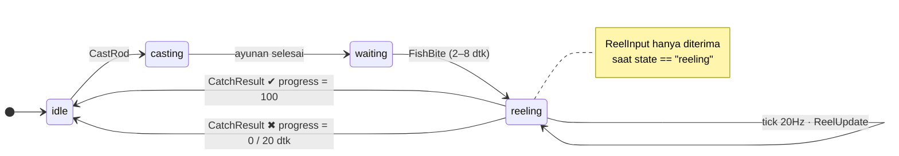
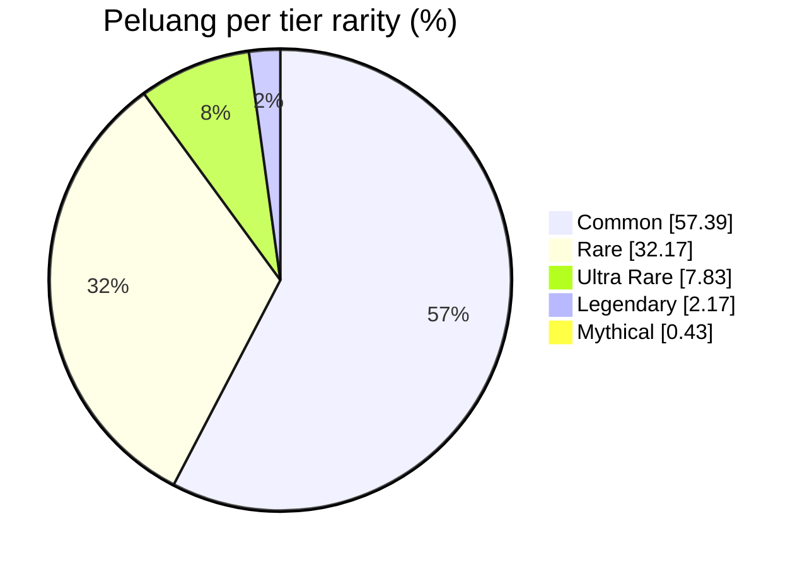
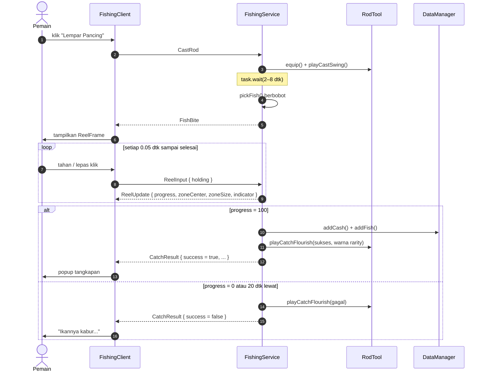

<a id="top"></a>

<div align="center">


<br/>


<br/><br/>


<br/><br/>

<a href="#about"><kbd> 🎣 Tentang </kbd></a>&nbsp;
<a href="#loop"><kbd> 🕹️ Cara Main </kbd></a>&nbsp;
<a href="#reel"><kbd> ⚡ Minigame </kbd></a>&nbsp;
<a href="#codex"><kbd> 📖 Fish Codex </kbd></a>&nbsp;
<a href="#drop"><kbd> 🎲 Drop Rate </kbd></a>&nbsp;
<a href="#map"><kbd> 🗺️ Peta </kbd></a>
<br/>
<a href="#arch"><kbd> 🛡️ Arsitektur </kbd></a>&nbsp;
<a href="#tree"><kbd> 🗂️ Struktur </kbd></a>&nbsp;
<a href="#install"><kbd> 🚀 Instalasi </kbd></a>&nbsp;
<a href="#config"><kbd> 🎛️ Konfigurasi </kbd></a>&nbsp;
<a href="#model"><kbd> 🧊 Model 3D </kbd></a>&nbsp;
<a href="#faq"><kbd> 🧰 FAQ </kbd></a>

<br/><br/>


</div>


<!-- ═══════════════════════════════════════════════════════════════ 01 -->
<a id="about"></a>


**Catch & Clash** adalah game mancing santai di Roblox. Kamu berdiri di pinggir kolam, lempar kail, tunggu pelampung goyang, lalu adu refleks di **minigame reel** yang semua hitungannya dijalankan server. Ikan yang berhasil ditarik jadi uang, uangnya masuk `leaderstats`, dan progresmu tersimpan di DataStore.

Semua visualnya dibangun prosedural: joran, ikan hias, gelembung, popup tangkapan, sampai terrain kolamnya. **Tidak ada satu pun mesh, decal, atau animasi eksternal** yang perlu di-upload.

<table>
<tr>
<td width="33%" valign="top">

### 🎯 Minigame reel
Indikator naik saat ditahan, turun saat dilepas. Jaga dia di dalam **zona ikan** yang terus bergeser acak sampai progress penuh.

</td>
<td width="33%" valign="top">

### 🌈 5 tier rarity
Common, Rare, Ultra Rare, Legendary, Mythical. Makin langka, zonanya makin sempit dan geraknya makin liar.

</td>
<td width="33%" valign="top">

### 🛡️ Anti-cheat bawaan
Client cuma boleh bilang *"tombol lagi ditahan"*. Progress, zona, dan hasil tangkapan dihitung 100% di server.

</td>
</tr>
<tr>
<td width="33%" valign="top">

### 🎣 Joran prosedural
`RodTool` merakit joran 4 segmen yang melengkung, reel, senar `Beam`, dan kail, lengkap dengan animasi lempar dan sentakan.

</td>
<td width="33%" valign="top">

### 🐟 Kolam yang hidup
`PondAmbience` menyebar 10 ikan hias dan 6 titik gelembung di sisi client, jadi server tidak terbebani sama sekali.

</td>
<td width="33%" valign="top">

### 💾 Progres tersimpan
`DataManager` menyimpan `Cash` dan `FishCaught` per pemain, aman walau place belum di-publish.

</td>
</tr>
</table>


<!-- ═══════════════════════════════════════════════════════════════ 02 -->
<a id="loop"></a>


| Aksi | Kontrol | Yang terjadi |
|:--|:--:|:--|
| Lempar kail | klik tombol **`Lempar Pancing`** | Joran ter-equip otomatis, animasi ayunan diputar, server mengacak waktu gigitan 2–8 detik |
| Narik | tahan <kbd>🖱️ Klik kiri</kbd> atau <kbd>Space</kbd> | Indikator naik **+55/detik** |
| Ngulur | lepas tombol | Indikator turun **−40/detik** |
| Menang | progress sampai **100** | Popup tangkapan berwarna sesuai rarity, uang bertambah |
| Kalah | progress jatuh ke **0** atau lewat **20 detik** | *"Ikannya kabur..."* |

<details>
<summary><b>🔍 Lihat state machine sesi pemain (Mermaid, bisa di-zoom)</b></summary>
<br/>



</details>


<!-- ═══════════════════════════════════════════════════════════════ 03 -->
<a id="reel"></a>


Animasi di bawah ini **bukan karangan**. Itu hasil port 1:1 dari `runReelMinigame()` ke Python, dijalankan dengan angka `Config.lua` yang asli melawan "pemain" bot yang sengaja dibuat agak ceroboh (telat bereaksi 300 ms dan kadang panik). Setiap frame di grafik adalah satu `ReelUpdate` yang dikirim server.


Tiap ikan punya angka `difficulty` (0–1) yang mengubah dua hal:

$$
\text{zoneSize} = 24 - (24 - 14)\cdot d \qquad\qquad \text{zoneSpeed} = 18\cdot(1 + d)
$$

Setiap tick ($\Delta t = 0.05$ dtk), progress bertambah atau berkurang tergantung posisi indikator:

$$
\text{progress}_{t+1} =
\begin{cases}
\text{progress}_t + 28\,\Delta t & \text{indikator di dalam zona}\\
\text{progress}_t - 18\,\Delta t & \text{di luar zona}
\end{cases}
$$

> [!TIP]
> Progress mulai dari **50**. Kalau indikator nempel di zona tanpa lepas, butuh minimal $50 / 28 \approx 1.79$ detik buat narik ikan apa pun. Sebaliknya, kalau meleset terus, ikan kabur setelah $50 / 18 \approx 2.78$ detik.

<details>
<summary><b>📜 Intip kode aslinya (FishingService.server.lua)</b></summary>
<br/>

```lua
-- Random-walk the zone center so it drifts unpredictably.
zoneVelocity += (math.random() * 2 - 1) * zoneSpeed * dt
zoneVelocity = clamp(zoneVelocity, -zoneSpeed, zoneSpeed)
zoneCenter = clamp(zoneCenter + zoneVelocity * dt, zoneSize / 2, Config.BarMax - zoneSize / 2)

if session.holding then
    indicator += Config.IndicatorRise * dt
else
    indicator -= Config.IndicatorFall * dt
end

local inside = indicator >= (zoneCenter - zoneSize / 2) and indicator <= (zoneCenter + zoneSize / 2)
progress += inside and Config.FillRate * dt or -Config.DrainRate * dt
```

</details>


<!-- ═══════════════════════════════════════════════════════════════ 04 -->
<a id="codex"></a>


<div align="center">

 
 
 
 
 

</div>

<details>
<summary><b>📊 Tabel mentah buat yang suka angka</b></summary>
<br/>

| # | Ikan | Rarity | Weight | Peluang | Rata-rata lemparan | Nilai | Difficulty | Zona | Kecepatan zona |
|--:|:--|:--|--:|--:|--:|--:|--:|--:|--:|
| 1 | Ikan Lele | ⚪ Common | 230 | 20.00% | 1 dari 5.0 | 5 | 0.10 | 23.0 | 19.8 |
| 2 | Ikan Mujair | ⚪ Common | 220 | 19.13% | 1 dari 5.2 | 8 | 0.12 | 22.8 | 20.2 |
| 3 | Ikan Nila | ⚪ Common | 210 | 18.26% | 1 dari 5.5 | 10 | 0.15 | 22.5 | 20.7 |
| 4 | Ikan Gurame | 🔵 Rare | 115 | 10.00% | 1 dari 10.0 | 28 | 0.30 | 21.0 | 23.4 |
| 5 | Ikan Kakap | 🔵 Rare | 105 | 9.13% | 1 dari 11.0 | 35 | 0.35 | 20.5 | 24.3 |
| 6 | Ikan Kerapu | 🔵 Rare | 150 | 13.04% | 1 dari 7.7 | 38 | 0.40 | 20.0 | 25.2 |
| 7 | Ikan Tuna | 🟣 Ultra Rare | 48 | 4.17% | 1 dari 24.0 | 75 | 0.50 | 19.0 | 27.0 |
| 8 | Ikan Hiu-Hiuan | 🟣 Ultra Rare | 42 | 3.65% | 1 dari 27.4 | 95 | 0.55 | 18.5 | 27.9 |
| 9 | Ikan Marlin | 🟠 Legendary | 25 | 2.17% | 1 dari 46.0 | 250 | 0.72 | 16.8 | 31.0 |
| 10 | Naga Laut | 🔴 Mythical | 5 | 0.43% | 1 dari 230.0 | 750 | 0.92 | 14.8 | 34.6 |

</details>


<!-- ═══════════════════════════════════════════════════════════════ 05 -->
<a id="drop"></a>


Begitu ikan menggigit, `pickFish()` melempar dadu berbobot. Setiap ikan punya `weight`, dan peluangnya adalah bobot itu dibagi total semua bobot:

$$
P(\text{ikan}_i) = \frac{w_i}{\sum_j w_j} = \frac{w_i}{1150}
\qquad\Rightarrow\qquad
\mathbb{E}[\text{uang per gigitan}] = \sum_i P_i \cdot v_i \approx 30.6
$$


<details>
<summary><b>🥧 Versi Mermaid (hover buat lihat angkanya)</b></summary>
<br/>



</details>

> [!NOTE]
> Komentar di `FishData.lua` menulis kisaran **~66% / 22% / 9% / 2.5% / 0.5%**, tapi kalau dihitung dari bobot yang sekarang, hasilnya **57.4% / 32.2% / 7.8% / 2.2% / 0.43%**. Penyebab utamanya Ikan Kerapu yang punya bobot 150, lebih besar dari dua ikan Rare lainnya. Angka di README ini memakai hasil hitungan asli.


<!-- ═══════════════════════════════════════════════════════════════ 06 -->
<a id="map"></a>


Kolam dibuat sekali jalan lewat `scripts/BuildPondTerrain.lua`: hapus `Baseplate`, isi tanah rumput 500×500, keruk cekungan, isi pasir dan air, lalu taruh `SpawnLocation` di daratan supaya pemain tidak muncul di tengah air. `PondAmbience` membaca angka yang sama (`SwimRadius = 36`, `MinY = -7`, `MaxY = -1.5`) supaya ikan hias tidak nembus pasir.

<details>
<summary><b>🧱 Cara menjalankan script terrain</b></summary>
<br/>

1. Buka Roblox Studio, masuk ke place kamu.
2. Buka **View → Command Bar**.
3. Copy seluruh isi [`scripts/BuildPondTerrain.lua`](scripts/BuildPondTerrain.lua), paste ke Command Bar, tekan <kbd>Enter</kbd>.
4. Output akan menampilkan `Kolam & terrain selesai dibuat!`

> [!WARNING]
> Script ini memanggil `Terrain:Clear()` dan menghapus `Baseplate`. Jangan dijalankan di place yang terrain-nya sudah kamu bentuk manual.

</details>


<!-- ═══════════════════════════════════════════════════════════════ 07 -->
<a id="arch"></a>


Prinsipnya sederhana: **client cuma pegang tombol, server pegang segalanya.** Satu-satunya data yang dikirim pemain selama minigame adalah `{ holding = true/false }`. Server sendiri yang menggeser zona, menggerakkan indikator, menghitung progress, memutuskan menang atau kalah, lalu membayar. Payload yang bukan tabel, atau dikirim saat state bukan `"reeling"`, langsung dibuang.

<details>
<summary><b>📡 Sequence diagram satu kali mancing</b></summary>
<br/>



</details>


<!-- ═══════════════════════════════════════════════════════════════ 08 -->
<a id="tree"></a>


```text
CatchAndClash_Roblox_Project/
├── 📄 default.project.json            ← peta Rojo: folder → service Roblox
├── 📂 scripts/
│   └── 🧱 BuildPondTerrain.lua        ← jalankan sekali di Command Bar
└── 📂 src/
    ├── 📂 ReplicatedStorage/Fishing/      (dibaca client & server)
    │   ├── 🎛️ Config.lua              ← semua angka balancing minigame
    │   ├── 🐟 FishData.lua            ← 10 ikan: rarity, weight, value, difficulty
    │   ├── 🌈 RarityData.lua          ← urutan tier + warna
    │   └── 📡 Remotes.lua             ← bikin & ambil 5 RemoteEvent
    ├── 📂 ServerScriptService/Fishing/    (server saja)
    │   ├── 🧠 FishingService.server.lua   ← loop mancing + minigame otoritatif
    │   ├── 💾 DataManager.lua         ← DataStore + leaderstats
    │   └── 🎣 RodTool.lua             ← joran prosedural + animasi
    └── 📂 StarterPlayer/StarterPlayerScripts/Fishing/   (client saja)
        ├── 🖥️ FishingClient.client.lua    ← UI, input, popup tangkapan
        └── 🫧 PondAmbience.client.lua     ← ikan hias + gelembung
```

<details>
<summary><b>🔗 Bagaimana Rojo memetakan folder</b></summary>
<br/>

| Folder di repo | Muncul di Studio sebagai |
|:--|:--|
| `src/ReplicatedStorage/Fishing` | `ReplicatedStorage.Fishing` |
| `src/ServerScriptService/Fishing` | `ServerScriptService.Fishing` |
| `src/StarterPlayer/StarterPlayerScripts/Fishing` | `StarterPlayer.StarterPlayerScripts.Fishing` |

Akhiran `.server.lua` jadi `Script`, `.client.lua` jadi `LocalScript`, dan `.lua` biasa jadi `ModuleScript`.

</details>


<!-- ═══════════════════════════════════════════════════════════════ 09 -->
<a id="install"></a>


> [!IMPORTANT]
> Butuh **Roblox Studio** dan **[Rojo](https://rojo.space)** 7.x (CLI + plugin Studio).

**① Clone repo**

```bash
git clone https://github.com/<username>/CatchAndClash_Roblox_Project.git
cd CatchAndClash_Roblox_Project
```

**② Nyalakan Rojo**

```bash
rojo serve
```

**③ Sambungkan Studio.** Buka place baru (Baseplate), klik plugin **Rojo → Connect**. Folder `Fishing` akan muncul di tiga service.

**④ Bangun kolam.** Jalankan [`scripts/BuildPondTerrain.lua`](scripts/BuildPondTerrain.lua) di Command Bar (lihat [Peta Kolam](#map)).

**⑤ Tekan <kbd>F5</kbd> dan mulai mancing!** 🎣

<details>
<summary><b>📦 Mau file .rbxlx tanpa live sync?</b></summary>
<br/>

```bash
rojo build -o CatchAndClash.rbxlx
```

File hasil build sudah di-`.gitignore`, jadi aman.

</details>

> [!TIP]
> Supaya progres benar-benar tersimpan saat testing, publish place-nya lalu aktifkan **Game Settings → Security → Enable Studio Access to API Services**. Tanpa itu game tetap jalan normal, hanya saja `DataManager` akan memberi warning dan tidak menyimpan apa-apa.


<!-- ═══════════════════════════════════════════════════════════════ 10 -->
<a id="config"></a>


Semua angka balancing ada di [`src/ReplicatedStorage/Fishing/Config.lua`](src/ReplicatedStorage/Fishing/Config.lua).

| Kunci | Default | Efek kalau dinaikkan |
|:--|--:|:--|
| `MinBiteTime` / `MaxBiteTime` | `2` / `8` | Nunggu gigitan makin lama |
| `TickRate` | `1/20` | Simulasi makin jarang (lebih ringan, kurang halus) |
| `BarStart` | `50` | Mulai lebih dekat ke kemenangan |
| `FillRate` | `28` | Progress naik lebih cepat saat di zona |
| `DrainRate` | `18` | Hukuman meleset makin berat |
| `IndicatorRise` | `55` | Indikator makin "lompat" saat ditahan |
| `IndicatorFall` | `40` | Indikator jatuh makin cepat saat dilepas |
| `ZoneMinSize` / `ZoneMaxSize` | `14` / `24` | Zona lebih lebar (lebih gampang) |
| `ZoneSpeed` | `18` | Zona makin liar |
| `ReelTimeLimit` | `20` | Waktu narik lebih panjang |

<details>
<summary><b>➕ Cara menambah ikan baru</b></summary>
<br/>

Tambahkan satu baris di [`FishData.lua`](src/ReplicatedStorage/Fishing/FishData.lua). Tidak ada file lain yang perlu diubah: peluang, warna popup, dan tingkat kesulitan langsung ikut.

```lua
{ name = "Ikan Arwana", rarity = "Legendary", weight = 20, value = 300, difficulty = 0.75 },
```

Ingat, menambah `weight` akan mengecilkan peluang semua ikan lain karena total bobotnya ikut naik.

</details>

<details>
<summary><b>🎨 Cara mengganti warna tier</b></summary>
<br/>

Ubah `color` di [`RarityData.lua`](src/ReplicatedStorage/Fishing/RarityData.lua). Warna ini dipakai di label popup, garis tepi popup, dan efek ikan yang terangkat dari air.

| Tier | RGB | |
|:--|:--|:--:|
| Common | `190, 190, 190` |  |
| Rare | `70, 160, 255` |  |
| Ultra Rare | `175, 80, 230` |  |
| Legendary | `255, 170, 40` |  |
| Mythical | `255, 60, 90` |  |

</details>


<!-- ═══════════════════════════════════════════════════════════════ 11 -->
<a id="model"></a>


Joran di game dirakit dari kode, bukan mesh. Model di bawah ini dibangun ulang dari ukuran, kemiringan (3°, 5°, 6°, 7°), dan offset yang sama persis dengan `buildTemplate()` di `RodTool.lua`. **Bisa diputar, di-zoom, dan di-geser langsung di GitHub.** File aslinya ada di [`assets/readme/fishing-rod.stl`](assets/readme/fishing-rod.stl).

<details open>
<summary><b>🧊 Viewer 3D interaktif (drag untuk memutar)</b></summary>
<br/>

```stl
%%STL%%
```

</details>


<!-- ═══════════════════════════════════════════════════════════════ 12 -->
<a id="faq"></a>


<details>
<summary><b>⚠️ Output menulis <code>[DataManager] DataStore unavailable...</code></b></summary>
<br/>

Normal kalau place belum pernah di-publish atau akses API Studio belum dinyalakan. `DataManager` sengaja membungkus `GetDataStore()` dengan `pcall`, jadi game tetap jalan, hanya progres sesi itu tidak disimpan. Publish place lalu aktifkan **Enable Studio Access to API Services**.

</details>

<details>
<summary><b>🐟 Ikan hias tidak kelihatan / berenang di luar kolam</b></summary>
<br/>

`PondAmbience` mengasumsikan kolam berada di `(0, 0, 0)` dengan radius air 42. Kalau kolammu dipindah atau diperbesar, ubah `PondConfig.Center`, `SwimRadius`, `MinY`, `MaxY`, dan `FloorY` di bagian atas file itu.

</details>

<details>
<summary><b>🎣 Joran tidak muncul di tangan</b></summary>
<br/>

`RodTool.give()` dipanggil saat pemain masuk dan setiap karakter respawn. Joran juga di-equip otomatis waktu kamu menekan **Lempar Pancing**. Kalau masih tidak muncul, cek apakah ada script lain yang mengosongkan `Backpack`.

</details>

<details>
<summary><b>🤔 Kenapa server yang menjalankan minigame? Bukannya bikin lag?</b></summary>
<br/>

Satu sesi minigame cuma beberapa operasi aritmatika per tick dan satu `FireClient` berisi 4 angka, 20 kali per detik, dan hanya untuk pemain yang sedang narik. Imbalannya, pemain tidak bisa memalsukan progress, mempercepat tangkapan, atau memilih ikan sendiri.

</details>

<details>
<summary><b>📈 Mau dipakai untuk server ramai?</b></summary>
<br/>

Komentar di `DataManager.lua` sudah menyarankan ini: untuk banyak pemain sekaligus, pertimbangkan library session-locking seperti **ProfileService / ProfileStore** supaya data tidak dobel saat pemain pindah server dengan cepat.

</details>

<br/>

<div align="center">


**Dibuat dengan Luau, Rojo, dan kesabaran menunggu pelampung goyang.**

<a href="#top"><kbd> ⬆️ Balik ke atas </kbd></a>

</div>
